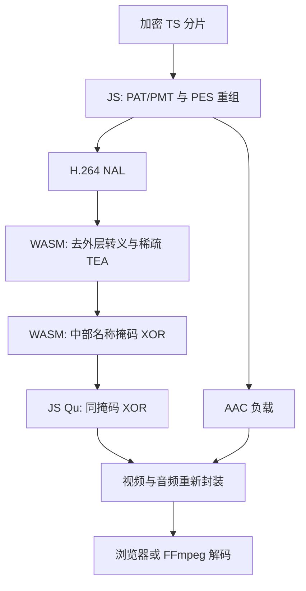

# CCTV 直播、点播 保护机制详解：视频加密、JS/WASM 虚拟化、环境检查与逆向复盘

> 分析日期：2026-10-24；本版为机制详解扩充版。本文同时解释“目标程序如何工作”和“我们怎样证明它”，以最终成功解码的结果为准。所有算法结论均限定于本次上传文件和其中的 H.264 加密模式 1。文中的编码端流程是由逆变换验证得到的等价实现，不是服务端源码。

### 声明: 本文由Chatgpt 6 astra撰写，输入为本人从浏览器抠出来的混淆代码 wasm，ai给出的脚本经过实测可以跑通，此仓库 文章为自己学习研究媒体编码而设，非破解用途，欢迎探讨问题，严禁滥用 再次多谢功臣: Chatgpt
<br>
<br>
  
## 阅读路线与证据边界

这次分析的目标不只是下载视频。用户此前已经通过 hook MSE、取得播放器输出的媒体碎片完成过保存；这次要追问的是：视频在进入 MSE 之前经历了哪些变化，JS 和 WASM 为什么必须配合，为什么单独拿到某一层输出仍然会失败。

| 想弄清楚的问题 | 建议阅读 |
| --- | --- |
| 视频到底在哪里、怎样被加密 | 第 4、7、9 节 |
| WASM 为什么依赖 JS 里的“指令” | 第 5 节，尤其 5.5–5.7 |
| 39 个导出函数分别是什么 | 第 5.4 节 |
| WASM 怎样读取浏览器环境 | 第 6.2、6.4 节 |
| TEA 后为什么还要两次 XOR | 第 8 节 |
| 域名、调用顺序、10 秒分别限制什么 | 第 6.3、11 节 |
| 怎么把明文还原成原来的密文进行验证 | 第 7.5、9.1、14.6 节 |
| 与 2023 年文章相比，哪里确实不同 | 第 19 节 |
| 拿到脚本后直接复现 | 第 2、14、17 节 |

全文使用三个证据层级：

- **已验证**：能在所给文件中定位，或由受控实验、逐字节差分证明。
- **等价重建**：独立实现与样本结果一致，但不代表原开发者使用同样的源码、函数划分或生产流程。
- **目的推断／未确认**：对保护意图的解释，或没有原始构建配置、服务端源码、旧二进制支持的判断。
# 直播
伪代码会明确标注。省略异常处理、内存管理或分支的示意，不应当被当成能直接替换原模块的完整实现。“本例成功”也不等于所有频道、所有模式、所有点播版本均适用。

## 1. 先记录最终结论

这份分片的保护发生在 H.264 NAL 数据内部：从 NAL 的一段未改动数据中读取 16 字节作为密钥，以 **16 轮 TEA、小端字序、8 字节独立块**处理稀疏位置。块起点依次是 NAL 偏移 `32、112、192……`，即每 80 字节处理 8 字节。

WASM 解密后还会在 NAL 中部异或 16 字节。掩码由播放器初始化标识派生；后续播放器 JS 的 `Qu(t, n)` 对相同位置再异或同样的掩码，两次运算抵消。因此，该掩码是 WASM 与后续 JS 之间的中间态保护，**最终视频明文不依赖猜出初始化标识**。

独立解密工具使用 **Python 3 标准库**，不需要运行 WASM，不需要浏览器，也不需要向服务器索取本路径的块密钥。Node.js 用于分析和复核播放器 JS；FFmpeg 用于全片解码验证和无损转封装。

最终验证结果：

| 项目 | 结果 |
| --- | --- |
| 输入大小 | 666,836 字节，3,547 个 TS 包 |
| 视频 | H.264，1280 × 720，25 fps |
| 视频帧 / slice 数 | 100 |
| 视频时长 | 4.000 秒 |
| 音频 | AAC，188 个可解码音频帧 |
| MP4 总时长 | 4.110 秒 |
| 完整解码 | TS 与 MP4 均通过 FFmpeg 严格解码检查，错误日志为空 |
| 独立算法与 WASM 对比 | 204 个 NAL 的 WASM 中间态逐字节一致，包括 100 个视频 slice |
| 原始 JS 后处理复核 | IDR、参考 P/B slice、非参考 slice 三组向量全部匹配 |
| 反向构造复核 | 对 100 个恢复后的 slice 独立执行逆变换，全部重建出原始加密 slice |
| 封装保留 | 非视频 PID 的 TS 包逐字节不变；所有 PCR 字段不变 |

**不要再沿用早期的两个判断：**“初始化名称是服务端解密密钥”和“WASM 输出就是最终视频明文”。新取得的上层 JS 证明了中间态之后还有一次处理。

### 1.1 先把三种“加密／混淆”分开

| 层次 | 被处理的对象 | 具体做法 | 正常运行时谁恢复 |
| --- | --- | --- | --- |
| 视频内容保护 | H.264 slice 的部分字节 | 从保留数据取 16 字节 key，稀疏执行 TEA | WASM 中执行的业务逻辑 |
| 跨层中间态保护 | TEA 恢复后的 NAL | 在中点连续 XOR 16 字节 | 上层播放器 JS `Qu` |
| 程序分析保护 | 函数、字符串、控制流、常量 | 字节码解释执行、字符串解码、状态调度、等价表达式等 | 原程序运行过程中逐步解释和求值 |

这三层不能合并成“一次复杂加密”。第一层改变从网络取得的视频；第二层只存在于同一客户端的两个处理阶段之间；第三层改变程序的表达方式，使人更难看出前两层。

例如，服务端没有必要知道页面 `<video>` 的 ID：该 ID 只影响客户端一加一消的 XOR。JS 里装载的 VM 字节码也不是视频密钥，它是描述“怎样计算”的程序内容。

### 1.2 设计上依赖了什么

从本样本可以观察到，完整播放器依赖媒体格式、装载器、解释器、环境导入、调用状态和后处理共同工作。保护的实际效果是：拿走某一块代码，通常不能立即复用。

但在本模式中，最终 TEA key 来自 NAL 内可取得的保留字节，跨层掩码又可以抵消。因而一旦取钥位置、字序、轮数和步长被还原，独立变换无需服务端秘密即可重建视频。这一结论来自当前数据路径，不能推广为该站点所有内容保护方式都相同。

“降低直接抠函数和复制播放器的便利程度”是对设计目的的推断；“哪几个字节被修改、怎样恢复”则有差分和逆变换证据。

## 2. 交付文件与直接运行方法

| 文件 | 用途 |
| --- | --- |
| `decrypt_cctv_ts.py` | 独立 TS 解密程序，Python 3.9+，算法本身无第三方依赖 |
| `CCTV_WASM_Analysis.md` | 本复盘笔记 |
| `verify_player_layer.cjs` | 可选的 Node.js 18+ 复核工具，执行所给播放器原始 `Qu` 函数 |
| `validation_vectors.json` | 从原 WASM 运行记录中选取的三个测试向量及独立最终结果 |
| `verification.json` | 实际样本的文件哈希、数量统计和验证结果 |

只解密，输出仍为 MPEG-TS：

```bash
python3 decrypt_cctv_ts.py \
  'cdrmldcctv13_1_1800-1792595050(2).bin' \
  decrypted.ts
```

解密、严格验证，并转为 MP4：

```bash
python3 decrypt_cctv_ts.py \
  'cdrmldcctv13_1_1800-1792595050(2).bin' \
  decrypted.ts \
  --verify \
  --mp4 decrypted.mp4 \
  --report run_result.json
```

第二条命令要求 `ffmpeg` 在 `PATH` 中。MP4 使用 `-c copy` 转封装，视频和音频不重新编码。脚本的输入、输出 TS、输出 MP4、输出 JSON 路径必须互不相同。

脚本自动读取 PAT/PMT 选择 H.264 PID；确有需要时可以显式指定：

```bash
python3 decrypt_cctv_ts.py input.bin output.ts --video-pid 0x100 --verify
```

`--assume-mode1` 仅供已经确认属于同一模式、但该段不含初始 SPS 的输入使用，不能用来猜测模式。输入从半个 PES 开始、跨 PES 分割 NAL、没有符合本格式的 AUD 等情况，会被脚本拒绝，见后面的适用范围。

## 3. 样本归档：先固定版本，避免分析错文件

| 文件 | 字节数 | SHA-256 |
| --- | ---: | --- |
| `out.bin` | 92,626 | `f94a1562f39764f8c538ec26e1259579f179d77dfc027010b64526a7a2157a69` |
| `live.worker.js` | 4,871,689 | `6dd48cc73249fe32cbc588d45e172e167d1310965592952b1f4970bd23712738` |
| `liveplayer_controls.js` | 1,995,762 | `5d2194022dc6b59da24cdae1b95af30df436a64a10e157ee6e19137ac90fe94b` |
| `cdrmldcctv13_1_1800-1792595050(2).bin` | 666,836 | `5a28a10fa0e2154b91f4e93a357f21e94cc8f373bd4d3f5828f385ef4ea56584` |

`out.bin` 实际是 WebAssembly 二进制。JS 中的 Base64 是同一份 WASM，分析时直接复用了已有文件；后面提取的是 **JS 另外装载的解释器字节码**，并非重复拆 Base64 WASM。

文件名中的频道、码率、时间戳只可作为检索线索，不能据此认定它们参与密钥派生。早期用文件名猜初始化标识没有完成全片验证，后来应当撤回这种推断。

## 4. 从 TS 结构确定分析层级

### 4.1 为什么先看封装

输入字节数满足：

```text
666836 / 188 = 3547
```

每个 TS 包开头都是 `0x47`。PAT、PMT、PES 以及视频参数都可以解析，说明应首先调查媒体负载内部的变换，而不是先对整个文件尝试 AES-CBC。

TS 头部的 `transport_scrambling_control` 均为 0。这个字段只描述传输包层的 scrambling，**不能据此认定上层视频内容没有自定义加密**。

| PID | 内容 / 流类型 |
| ---: | --- |
| 0 | PAT |
| 4096 | PMT |
| 256 | H.264 视频，stream_type `0x1b` |
| 257 | AAC 音频，stream_type `0x0f` |
| 17 | SDT |

视频 PID 共 100 个 PES，本样本每个视频 PES 包含一个完整 access unit，并以 AUD 开始。重组后得到以下 NAL：

| NAL 类型 | 头字节 | 数量 |
| --- | --- | ---: |
| AUD，type 9 | `09` | 100 |
| SPS，type 7 | `67` | 2 |
| PPS，type 8 | `68` | 2 |
| IDR slice，type 5 | `65` | 2 |
| 非 IDR slice，type 1，参考标志非零 | `41` | 59 |
| 非 IDR slice，type 1，参考标志为零 | `01` | 39 |
| 总计 | | 204 |

因此不能把它简化成“只加密两个关键帧”或“只加密参考帧”。独立解密处理了全部 100 个 slice。

### 4.2 原始文件能识别不代表解密成功

FFprobe 能识别 H.264 参数和 AAC，并不证明视频负载正确。原片会出现 `error while decoding MB`、`Reference ... >= ...` 等错误。

类似地，FFmpeg 默认可能隐藏、补偿错误后继续输出帧。分析中把“有画面”“能读出 100 帧”“一个 IDR 没报错”都视为弱证据；最终必须检查完整分片的严格解码结果。

AAC elementary stream 可直接无错误解码，后来又验证了所有非视频 TS 包未被工具改动。本次最终工具只处理视频 PID。

### 4.3 PAT、PMT、PES、NAL 和 mdat 的关系

| 名称 | 所属层 | 作用 | 本例是否在这里直接做 TEA |
| --- | --- | --- | --- |
| M3U8 | HLS 播放列表 | 列出分片地址、时长、序号等 | 否 |
| TS packet | MPEG-TS，标准包长 188 字节 | 用 PID 标识负载归属，交织视频、音频和表 | 否 |
| PAT | TS 的 PSI 表，PID 0 | 从节目号找到 PMT 的 PID | 否 |
| PMT | TS 的 PSI 表 | 给出该节目的各路流 PID、类型等 | 否 |
| PES | 媒体流的分组 | 承载媒体字节及 PTS/DTS 等头部信息 | 本例处理其视频负载中的 NAL |
| NAL unit | H.264 编码层 | 承载 slice、参数集、分隔符等 | 是，类型 1、5 的指定位置 |
| mdat | MP4 box | 储存媒体 sample 的字节 | 输入是 TS；转封装后才涉及 MP4 结构 |

PAT 指向 PMT，PMT 指示哪些 PID 是视频和音频。这是查找关系，不是 PAT 里面物理嵌套 PMT、PMT 再包住 PES。媒体 PES 通常被拆成多个 TS packet 负载；按 PID 和起始标志重组后才能得到完整数据。

NAL 也不等于一帧：SPS、PPS 不包含一幅图像；一幅图像可以有多个 slice NAL。本段恰好是 100 个视频 PES、100 个 access unit、100 个 slice，不应把这个巧合写成格式规则。

常见 AVC-in-MP4 会用长度字段划分 NAL，Annex B 则用起始码划分；长度字段宽度由配置决定，不应永远写死为 4。`mdat` 可以包含视频或音频 sample，也不是 H.264 专用容器。普通 MP4 的索引与时间信息主要位于 `moov`；分片 MP4 的媒体段通常结合 `moof` 的元数据与 `mdat` 的样本字节。

### 4.4 从编码端看，加密应该插在哪里

以下为与样本字节变换一致的两种**可能生产流程**，没有取得服务端源码来判定实际采用哪一种。

**如果从编码器输出开始处理：**

1. 编码器输出 H.264 NAL 和 AAC 数据。
2. 对选中的视频 slice NAL 做第 7 节的稀疏 TEA 加密。
3. 给加密后的 NAL 加一次外层防竞争字节处理，恢复 Annex B 分隔。
4. 封装视频 PES，携带相应时间信息；音频沿自己的封装路径处理。
5. 用视频 PID、音频 PID 等复用为 TS，包含必要的 PAT/PMT。
6. 发布 TS 分片，并在 M3U8 中列出它们。

**如果输入已经是 TS：**需要先解析 PAT/PMT 找到视频 PID，重组 PES、取出 NAL，修改后再重建 TS。这里才有“先挑出视频 PID”这个步骤。

所以“挑视频 PID → 加密 → 塞回 PES → TS”适合描述处理已有 TS 的实现；直接处理编码器输出时，尚未分配 PID，也能完成同样的 NAL 变换。

M3U8 是清单，不是再套一层二进制容器。下面的示意只描述分片引用关系，不是本次真实播放列表：

```m3u8
#EXTM3U
#EXT-X-TARGETDURATION:4
#EXT-X-MEDIA-SEQUENCE:1
#EXTINF:4.000,
segment001.ts
#EXTINF:4.000,
segment002.ts
```

### 4.5 为什么只改一部分字节也会花屏

压缩视频字节不能理解成“一个字节等于一个像素”。slice 中包含预测、运动信息和熵编码数据；某个位置错误，可能改变后续符号的解释，并通过帧间参考传播。

每 80 字节只修改 8 字节，仍能使普通解码器失败，同时降低处理量。这里的 10% 是步长区间的比例，不是“只让 10% 像素损坏”，也不是对所有文件恰好修改 10% 的承诺：头部、尾部、短 NAL 和未处理的音频都要另算。

TS 和参数集仍可解析，所以播放器、FFprobe 能识别轨道和分辨率，而视频画面仍然花屏。这正是先分析封装、再定位 NAL 的依据。

## 5. WASM 接口、虚拟指令与 JS 装载机制

### 5.1 使用的分析工具

- Python：文件结构解析、字节码提取、差分统计、算法还原、TS 重建。
- Node.js：执行 Emscripten 装载器、模拟必要浏览器导入、观察调用参数、执行播放器原始 JS 后处理。
- WABT：`wasm-objdump`、`wasm2wat`、`wat2wasm`、`wasm-decompile`。
- Acorn / Astring / Prettier：辅助解析和格式化混淆 JS。
- FFmpeg / FFprobe：完整解码、音视频信息检查、无损转封装。

复现静态查看的方法，例如：

```bash
npm install --prefix analysis_tools wabt@1.0.39 acorn astring prettier

analysis_tools/node_modules/.bin/wasm-objdump -x out.bin > sections.txt
analysis_tools/node_modules/.bin/wasm2wat out.bin -o out.wat
```

`wasm-decompile` 对深度嵌套的解释器函数失败过。为阅读其他函数，曾在**分析副本**里把解释器体替换为占位体，再反编译其余部分；这只用于静态展示，不能拿该副本执行解密或认为伪 C 包含完整业务。

### 5.2 关键统计与包装形态

原模块有 52 个函数导入、431 个定义函数和 39 个导出。定义函数中 415 个属于进入解释器的薄包装；原始函数 52 是解释器核心。

典型包装的意义是：准备参数寄存器，然后解释执行 `env.d + 某个偏移` 的字节码。只反编译这个包装函数，看到的当然不会是完整 TEA 算法。

| 接口 | 原 WASM 函数编号 | 字节码入口 / 作用 |
| --- | ---: | --- |
| `_CNTV_InitPlayer` | 72 | 原生混淆函数，创建上下文 |
| `_CNTV_UpdatePlayer` | 171 | 原生混淆函数，按标识查找状态 |
| `_CNTV_jsdecLive0` | 99 | `N + 1111580` |
| `_CNTV_jsdecLive1` | 100 | `N + 1265740` |
| `_CNTV_jsdecLive2` | 101 | `N + 1196064` |
| `_CNTV_jsdecLive3` | 102 | `N + 1137080` |
| `_CNTV_jsdecLive4` | 103 | `N + 1308300` |
| `_CNTV_jsdecLive5` | 104 | `N + 1282244` |
| `_CNTV_jsdecLive6` | 105 | `N + 1124276` |
| `_CNTV_jsdecLive7` | 106 | `N + 1207284` |
| `_CNTV_jsdecLive8` | 123 | `N + 408168`，主要视频处理入口 |

这里的 `N` 是装载后的字节码基址，即相关导入 `env.d`。**字节码偏移、WASM 文件偏移、线性内存地址是三种不同坐标。** 插入新的函数导入后，WASM 函数编号也会改变，因此上表统一使用原模块编号。

### 5.3 为什么主要指令在 JS 中

`live.worker.js` 除了内嵌 WASM，还预留解释器栈和字节码空间，然后执行 153 次 `F.set(...)`。这些数组总共装入 **1,558,792 字节**的 Emterpreter 字节码，之后还会做地址重定位。

可用下面这段版本针对性的代码提取，不会碰内嵌的 Base64 WASM：

```python
import re
from pathlib import Path

source = Path('live.worker.js').read_text(encoding='utf-8')
chunks = re.findall(
    r'F\.set\(\[([0-9,]+)\],N\+([0-9e]+)\)', source)
assert len(chunks) == 153
bytecode = bytearray(1558792)
for values, offset in chunks:
    data = bytes(map(int, values.split(',')))
    start = int(float(offset))  # 本文件包含 1024e3 一类科学计数法偏移
    bytecode[start:start + len(data)] = data
Path('emterpreter.bin').write_bytes(bytecode)
```

该提取结果的 SHA-256 为：

```text
3a9b7c7fb31ec14e7353d1fcd7705bda167892eb7d45056ea4fa3cf0983105ed
```

解释器格式与 Emscripten Emterpreter 的公开实现相符。本次使用 [Emscripten 1.38.28 的 emterpretify.py](https://github.com/emscripten-core/emscripten/blob/1.38.28/tools/emterpretify.py) 对照 opcode；这不能证明样本恰好由这个编译器版本构建。

与分析最相关的 opcode：

| Opcode | 作用 |
| --- | --- |
| `SETVI / SETVIB` | 载入常量 |
| `LOAD32 / LOAD32AV` 等 | 读线性内存 |
| `STORE32 / STORE8` 等 | 写线性内存 |
| `INTCALL`，134 | VM 内部函数调用 |
| `EXTCALL`，135 | 解释器向外调用 |
| `SWITCH`，138 | 分支表，常用于混淆状态调度 |
| `RET`，139 | 返回 |
| `FUNC`，140 | 函数头 |

**分析时踩过的一个坑：**只在 WASM 函数 52 的入口加日志，能看到原生包装进入解释器，但会漏掉 VM 自身的 `INTCALL`。后面在逐指令取指处增加了观测点，记录字节码 PC、当前寄存器帧和访存，才把内部运算连起来。

### 5.4 全部 39 个导出：接口含义与实现方式是两回事

本次重新对照导出表与 JS 绑定，共 **39 个导出，全部是函数**。其中 **29 个是指定字节码入口的包装，10 个直接由 WASM 指令实现**。模块内“431 个定义函数、415 个 VM 包装”是另一个统计口径，包含大量没有直接导出给 JS 的内部函数。

“直接 WASM 实现”不等于无混淆，也不保证不调用其他辅助函数；“VM 包装”不等于没有业务含义。`Live8` 仍然是有确定参数和返回约定的媒体处理接口，只是主体在虚拟指令中。

| WASM 导出名 | JS 对外绑定名 | 原函数编号 | 实现入口 |
| --- | --- | ---: | --- |
| `ca` | `_CNTV_InitPlayer` | 72 | 直接 WASM 实现 |
| `da` | `_CNTV_UnInitPlayer` | 258 | `N + 1319960` |
| `ea` | `_CNTV_UpdatePlayer` | 171 | 直接 WASM 实现 |
| `fa` | `_CNTV_jsdecLive0` | 99 | `N + 1111580` |
| `ga` | `_CNTV_jsdecLive1` | 100 | `N + 1265740` |
| `ha` | `_CNTV_jsdecLive2` | 101 | `N + 1196064` |
| `ia` | `_CNTV_jsdecLive3` | 102 | `N + 1137080` |
| `ja` | `_CNTV_jsdecLive4` | 103 | `N + 1308300` |
| `ka` | `_CNTV_jsdecLive5` | 104 | `N + 1282244` |
| `la` | `_CNTV_jsdecLive6` | 105 | `N + 1124276` |
| `ma` | `_CNTV_jsdecLive7` | 106 | `N + 1207284` |
| `na` | `_CNTV_jsdecLive8` | 123 | `N + 408168` |
| `oa` | `_CNTV_jsdecVOD0` | 88 | `N + 1060724` |
| `pa` | `_CNTV_jsdecVOD1` | 89 | `N + 1218824` |
| `qa` | `_CNTV_jsdecVOD2` | 90 | `N + 1247504` |
| `ra` | `_CNTV_jsdecVOD3` | 91 | `N + 1229084` |
| `sa` | `_CNTV_jsdecVOD4` | 92 | `N + 1046604` |
| `ta` | `_CNTV_jsdecVOD5` | 93 | `N + 1149632` |
| `ua` | `_CNTV_jsdecVOD6` | 94 | `N + 1174788` |
| `va` | `_CNTV_jsdecVOD7` | 95 | `N + 1256636` |
| `wa` | `_CNTV_jsdecVOD8` | 122 | `N + 288472` |
| `xa` | `_GetAudioARG` | 205 | `N + 1482540` |
| `ya` | `_GetDecryptAudio` | 318 | `N + 1460928` |
| `za` | `__ZSt18uncaught_exceptionv` | 154 | `N + 1556492` |
| `Aa` | `___embind_register_native_and_builtin_types` | 150 | `N + 1475148` |
| `Ba` | `___errno_location` | 69 | `N + 1558352` |
| `Ca` | `___getTypeName` | 225 | `N + 1545500` |
| `Da` | `_free` | 64 | 直接 WASM 实现 |
| `Ea` | `_jsfree` | 153 | `N + 1478668` |
| `Fa` | `_jsmalloc` | 184 | `N + 1454624` |
| `Ga` | `_main` | 300 | `N + 1464580` |
| `Ha` | `_malloc` | 65 | 直接 WASM 实现 |
| `Ia` | `_strlen` | 63 | 直接 WASM 实现 |
| `Ja` | `dynCall_v` | 129 | 直接 WASM 实现 |
| `Ka` | `dynCall_vi` | 130 | 直接 WASM 实现 |
| `La` | `emtStackRestore` | 128 | 直接 WASM 实现 |
| `Ma` | `emtStackSave` | 127 | 直接 WASM 实现 |
| `Na` | `globalCtors` | 142 | `N + 1553468` |
| `Oa` | `stackAlloc` | 148 | 直接 WASM 实现 |

`VOD`、音频接口的名称和字节码入口可以静态确认，但本文没有完成这些路径的算法验证。不能从存在 `_GetDecryptAudio` 推出本次 AAC 已被加密，也不能从存在九个 VOD 入口推出它们与 Live 的功能完全相同。

### 5.5 JS 究竟装进了什么“指令”

同一份 worker 里有两类外观都像“大段数据”的内容：

| 数据 | 被谁读取 | 实际意义 |
| --- | --- | --- |
| Base64 解码后的 `out.bin` | 浏览器 WebAssembly 引擎 | 标准 WASM 模块，包含解释器、原生函数、包装等 |
| 153 段 `F.set` 数组 | WASM 内的解释器 | Emterpreter 指令、立即数及相关数据 |

`F` 是同一线性内存的字节视图。JS 把数组复制到 `N` 起始的区域，WASM 使用内存读取指令就能访问它。这里“共享”是 JS 与 WASM 看同一缓冲区，不表示一定启用了跨线程 `SharedArrayBuffer`。

装载器中能定位到的实际结构为：

```js
// 原文件片段，略去了数组和其他初始化内容。
lb = (..., va(1048576));
N = va(1558792);
F.set([140, /* ... */], N + 0);
// 其余 F.set 分块写入。
for (var B = 0; B < A.length; B++) {
    L[N + A[B] >> 2] += N;
}
```

最后一个循环就是重定位。本次提取到的重定位数组包含 **45,994 个条目**；条目表示“需要修正的 32 位地址字段位于字节码哪里”。对于某个条目 `r`，它做的事情可展开为：

```text
字段位置 = N + r
原字段内容 = 相对字节码区域的目标偏移 t
更新后字段内容 = N + t
```

所以不能只把十进制数组拼出来就宣称得到了“可在任意地址直接执行的模块”。静态分析可以使用未重定位的相对坐标；真正运行时要与解释器的基址、栈和地址约定一致。

这些数组是程序字节码，不是一个能够直接交给 `WebAssembly.instantiate` 的第二份标准 WASM 模块。浏览器也不会直接把它当 JS 源码执行。

### 5.6 一个导出如何落到虚拟机内部

`Live8` 的原函数编号为 123。省略异步状态处理后，其实际 WAT 骨架是：

```wasm
;; 参数写入虚拟机寄存器帧：frame+8、+16、+24、+32。
global.get 6
local.get 0
i32.store offset=8
;; 另外三个参数类似，略。

global.get 4
i32.const 408168
i32.add
call 52

global.get 6
i32.load
```

这里 `global 4` 对应字节码基址；`global 6` 用于当前 VM 参数／寄存器帧。四个参数按 8 字节槽位间隔写入，解释器返回后从帧中读取返回值。因此 JavaScript 仍然看到普通的四参数函数调用，虚拟化细节藏在包装内部。

未重定位字节码在偏移 `408168` 的前 8 字节为：

```text
8c 04 1c 00 00 00 00 00
```

按对照的 Emterpreter 格式，`0x8c = 140` 为 `FUNC`，后续字段表示 4 个参数、28 个局部槽位及解释器类型等信息。它提供了比“看起来像一个 VM”更具体的结构证据。

解释器的一般行为可用下面的**概念伪代码**理解；实际指令可能有额外立即数、变长参数以及不同的 PC 更新规则：

```js
function interpret(pc, frame) {
    for (;;) {
        const instruction = readInstruction(pc);
        switch (instruction.opcode) {
            case LOAD32:
                writeRegister(frame, instruction.dst,
                              readMemory32(resolveAddress(instruction)));
                break;
            case ADD:
                // 从虚拟寄存器取数，执行 32 位加法，写回。
                break;
            case INTCALL:
                // 建立 VM 内部调用帧，转到另一个字节码地址。
                break;
            case EXTCALL:
                // 按调用表转到解释器外的函数。
                break;
            case RET:
                // 返回 VM 调用者，或结束本次解释器调用。
                break;
        }
        pc = nextInstructionAddress(instruction, pc);
    }
}
```

`EXTCALL` 的“外部”是相对于这层解释器，不等于每次都去 JS 或网络；它也可以转到模块里的直接 WASM 函数。`INTCALL` 则可以一直留在同一解释器循环里，这就是只 hook 函数 52 的入口会漏掉内部调用的原因。

### 5.7 从开发者视角怎样构造这种混淆

从产物可以逆推出一种合理的构建思路：

1. 把程序中的一批函数转换成虚拟指令序列。
2. 给需要从外面调用的函数生成小包装，负责参数、入口偏移和返回值。
3. 将解释器及其他保留函数编译成 WASM。
4. 把虚拟指令序列放进 JS 的数据数组，由装载器写入内存并重定位。
5. 对部分 JS 名称、属性访问和字符串做额外混淆；部分原生／字节码逻辑再呈现状态调度与等价算术。

这是**与产物相符的构建模型**。我们没有原始工程、构建命令或完整混淆流水线，所以不能断言各步骤的先后、具体商业产品名称，或某套 OLLVM 参数。Emterpreter 本身是执行机制，采用它也不能单独证明作者仅为反逆向；结合本模块的其他保护，才说明它增加了当前分析难度。

还要区分“压缩”和“隐藏逻辑”：Base64 只改变 WASM 的存放形式；短变量名主要抹掉语义线索；虚拟化改变需要分析的指令层；字符串解码和控制流混淆又把含义推迟到运行时。它们解决的不是同一个问题。

## 6. 动态执行：WASM 到底吃什么、返回什么

### 6.1 不是直接把整个 TS 塞进去

本路径的接口可表示为：

```c
int CNTV_jsdecLive8(
    int namePtr,
    int dataPtr,
    int nalLength,
    int urlLength
);
```

| 参数 | 已确认的含义 |
| --- | --- |
| `namePtr` | 以 NUL 结尾的初始化标识，位于 WASM 线性内存 |
| `dataPtr` | 单个 NAL 的地址，包含 NAL 头，不包含 Annex B 起始码 |
| `nalLength` | 该 NAL 的输入长度 |
| `urlLength` | 附带 URL 的字节数；URL 紧接在 `dataPtr + nalLength` 后 |
| 返回值 | 有效输出长度 |
| 输出数据位置 | 仍在 `dataPtr` 指向的内存，原地修改 |

JS 侧等价操作是：

```js
module.HEAPU8.set(nal, dataPtr);
// 需要提交 URL 时，再写到 dataPtr + nal.length。
const size = module._CNTV_jsdecLive8(
  namePtr, dataPtr, nal.length, urlByteLength
);
const intermediateNal = module.HEAPU8.slice(dataPtr, dataPtr + size);
```

`size` 必须使用真实返回值，不能固定按原长度读回。移除外层防竞争字节后，有些 NAL 会变短。

### 6.2 需要哪些宿主环境

分析使用离线 Node.js VM 和原 Emscripten JS 装载器，提供线性内存、函数表、必要的 `location`、字符串转换与时间导入。没有把未知 `eval` 表达式无条件执行，而是先记录，确认本路径解出的 `self.location.host` 再按实验环境返回。

相关导入包括：

| 导入 | 本次确认的用途 |
| --- | --- |
| `env.g` | `Date.now()` 风格毫秒时钟 |
| `env.f` | `gettimeofday` |
| `env.y` | 指针转 JS 字符串后执行表达式的桥 |
| `env.E / env.D` 等 | embind 全局对象与属性访问 |
| `env.q` | Emscripten fetch 入口 |

初始化会请求 `/Library/H5player.json`。公开响应包含版本、MD5、构建时间一类元数据；成功回调会更新内部状态。**未观察到该响应提供本视频路径的 TEA 密钥。**

最初缺失 IndexedDB 导入时，fetch 错误回调发生递归，造成栈溢出。后续通过记录 fetch 并模拟响应回调排除了这个宿主环境问题。不能把环境补全失败直接当作反调试证据。

### 6.3 状态和参数检查

`_CNTV_InitPlayer` 返回的整数是内部状态值，不是字符串名称，也不是上下文指针。上下文由名称查找，`_CNTV_UpdatePlayer` 返回当前状态。

`Live0…7` 主要操作不同位置的状态位，`Live8` 包含 `0x77777777` 门槛检查。重复调用某些入口还会重新随机化状态。播放器 JS 通过自己的映射表和状态字符选择调用项，因此不能照编号无条件执行九个函数，也不能把这九个名字当成九种任选算法。

实际 JS 映射也能解释为什么看函数名会被误导：

| `StaticCallModuleLive` 中的键 | 实际调用 |
| --- | --- |
| `H264NalSet` | `_CNTV_jsdecLive7` |
| `H265NalData` | `_CNTV_jsdecLive6` |
| `AVS1AudioKey` | `_CNTV_jsdecLive5` |
| `HEVC2AAC` | `_CNTV_jsdecLive4` |
| `HASHMap` | `_CNTV_jsdecLive3` |
| `BASE64Dec` | `_CNTV_jsdecLive2` |
| `MediaSession` | `_CNTV_jsdecLive1` |
| `Mp4fragment` | `_CNTV_jsdecLive0` |
| `MpegAudio` | `_CNTV_jsdecLive8` |

普通直播路径把状态写成补齐 8 位的十六进制字符串 `self.vmpTag`。`StaticCallModuleLiveMap` 接受字符 `0` 到 `6`；遍历状态字符时，按字符位置选择上表前八项，随后执行第九项。等价示意为：

```js
const tag = (state >>> 0).toString(16).padStart(8, '0');
for (let position = 0; position < 8; position++) {
  if ('0123456'.includes(tag[position])) {
    module['_CNTV_jsdecLive' + (7 - position)](
      namePtr, dataPtr, nalLength, urlLength);
  }
}
const size = module._CNTV_jsdecLive8(
  namePtr, dataPtr, nalLength, urlLength);
```

这里省略了 JS 桥接、分配和异常处理，只说明映射顺序。字符串最高位对应 Live7、最低位对应 Live0；因此不能用“把 Live0 到 Live7 每个都跑一遍”替代实际规则。

动态测试曾通过直接设置私有字段来隔离研究某个分支；这是定位手段，不能作为“原程序自然成功”的证明。之后完成了原初始化、状态入口和附带 URL 的调用流程，再做正式差分，最后一轮没有改写私有状态开关。

### 6.4 WASM 怎么“拿到 BOM”：三条具体通道

本模块没有直接读 `window.location` 的 WASM 指令。访问浏览器对象需要经过宿主 JS，或者由 JS 先把字符串写到内存。

**通道一：数字返回值。** 原 worker 的导入对象中有：

```js
g: function () { return Date.now(); }
```

WASM 调用导入 `env.g`，JS 返回毫秒数。WASM 自己保存时间、做减法和分支判断。导入函数可以在运行过程中被反复调用，绝不是初始化时只传了一份固定的“环境快照”。

**通道二：表达式／字符串桥。** 该文件还有下面的实际结构：

```js
jb = [function(a) {
    a = E(a);       // 从 WASM 内存读取字符串
    a = eval(a);    // 在 JS 环境中求值
    var b = Ba(a) + 1, d = A(b);
    H(a, F, d, b);  // 将结果字符串写回线性内存
    return d;      // 返回字节地址
}];

// 导入对象中的桥接项
y: function(A, B) { return jb[A](B); }
```

分析中记录到的表达式是 `self.location.host`。这是“WASM 提交字符串表达式 → JS 求值 → JS 把字符串结果编码回内存 → WASM 收到指针”的往返。`eval` 是这里实际存在的桥接方式，不是说所有 WASM 必须依赖 `eval`。

**通道三：emval 对象句柄。** 原 JS 的相关导入形态是：

```js
E: function(A) {
    return A === 0 ? Kc(Uc()) : Kc(Uc()[Tc(A)]);
},
D: function(A, B) {
    return Kc(Pc(A)[Pc(B)]);
}
```

这里的辅助函数负责全局对象、对象表、字符串与句柄转换。可以概念化为：取得全局对象的整数句柄，再请求某个属性，把属性结果登记进 JS 对象表，返回另一个句柄。`location` 对象仍留在 JS 中；WASM 拿到的整数是对象表索引，不是可直接解引用的浏览器对象地址。

这些通道之外，第 6.1 节的附带 URL 是更直接的数据传参：JS 已经知道字符串，就把字节放在 NAL 后面，WASM 根据指针和长度读取。它不需要再通过属性桥取同一个字符串。

### 6.5 四种“整数”不能混为一谈

| 看起来都是整数 | 实际含义 | 如何使用 |
| --- | --- | --- |
| `namePtr`、`dataPtr` | 线性内存中的字节偏移 | 用 HEAP 视图读取 |
| emval handle | JS 对象表里的编号 | 必须经过对应 JS 桥接 |
| Init/Update 返回值 | 播放器调用状态 | 按状态规则选择后续入口 |
| Live8 返回值 | 有效输出字节数 | 决定从缓冲区复制多少字节 |

拿状态当指针可能读到无关内存；拿对象句柄当指针也不会得到完整 JS 对象。反过来，返回一个数字不意味着函数没有产生数据：Live8 的主要输出是原地修改的缓冲区。

### 6.6 正常调用状态为何也是一种保护

JS 不只调用算法，还承担流程协调：同一名称定位同一上下文；状态字决定前置调用；可选 URL 更新检查结果；SPS 设置模式；处理结束还有 `Qu`。这些依赖让单独复制一个导出函数的做法更容易得到原样返回、异常长度或中间态。

这仍然是客户端约定。我们完成算法提取后，独立程序不必仿造这一整套约定。它直接从 NAL 中读取密钥并恢复字节；把“能够正常调用原模块”和“能够独立实现视频变换”分开，是本次分析的重要转折。

## 7. 从访存轨迹还原视频算法

### 7.1 模式来自 SPS

本样本第一个 SPS 的开头：

```text
67 64 01 28 ac 72 ...
```

该路径检查 `0x67`，取 `SPS[2] & 3`，本样本为 1。SPS、PPS 可以直接读出参数，不意味着后续 slice 是完整明文。

在本样本中，NAL 长度小于 129 字节的路径不会执行下面这组 slice 块变换。这个条件也解释了为何拿很短的截断输入做实验时可能原样返回。

### 7.2 统一坐标，避免把密钥读错

以下偏移都满足三个前提：

1. 输入为一个 NAL，不是 TS 包或 PES 头。
2. NAL 头字节是偏移 0，不计 `00 00 01` / `00 00 00 01` 起始码。
3. 已经移除了本加密层引入的防竞争字节。

可观察到的布局：

| 范围 | 本模式中的用途 |
| --- | --- |
| `0..15` | 不参加稀疏 TEA 块处理 |
| `16..31` | 读取为四个小端 32 位密钥字，同时保留原数据 |
| `32..39` | 第一个 TEA 块 |
| `40..111` | 跳过 |
| `112..119` | 第二个 TEA 块 |
| 后续 | 每 80 字节处理一个完整的 8 字节块 |

这里应表述为“**从保留的数据中取密钥**”。并没有取得编码端源码，不能把它扩大为“服务端一定专门插入了一个额外 16 字节密钥字段”；这些位置保留在恢复后的合法视频字节流中。

### 7.3 为什么判定为 16 轮 TEA

访存显示每次读取两个 32 位数据字和四个密钥字，使用左移 4、逻辑右移 5、加减法与异或。化简混淆算术后，得到 TEA 的结构。

有效参数是：

```text
block size = 8 bytes
key size   = 16 bytes
word order = little-endian
cycles     = 16
delta      = 0x9e3779b9
start sum  = 0xe3779b90  (delta * 16 mod 2^32)
```

这里“16 轮”指 16 次完整的双字更新，也就是代码中循环 16 次。不同文献对 half-round 的计数可能不同，应以循环体为准。

混淆代码不是直接摆出所有标准常量。例如：

```text
0x9e3779a9 XOR 0x10       = 0x9e3779b9
0xbaa69da2 XOR 0x59d10632 = 0xe3779b90
```

此外夹杂常量加后再减、按位布尔恒等式等。一个常见化简例子：

```text
(x & ~y) | (~x & y) = x XOR y
```

因此不能仅靠是否明文出现 `0x9e3779b9` 判断有没有 TEA。

核心解密代码：

```python
import struct

def tea16_decrypt(block, key):
    left, right = struct.unpack('<2I', block)
    total = 0xe3779b90
    for _ in range(16):
        right = (right - (((left << 4) + key[2]) ^
                          (left + total) ^ ((left >> 5) + key[3]))) & 0xffffffff
        left = (left - (((right << 4) + key[0]) ^
                        (right + total) ^ ((right >> 5) + key[1]))) & 0xffffffff
        total = (total - 0x9e3779b9) & 0xffffffff
    return struct.pack('<2I', left, right)
```

Python 整数不会自动溢出，因此必须保留 `& 0xffffffff`。右移操作作用于已经限制在无符号 32 位范围内的数值，避免误用有符号算术右移。

第一个 IDR 的数值证据：

```text
NAL length                    82015
key = NAL[16:32]              b29084ddad4b1c62ad21b1cf0b05add0
ciphertext = NAL[32:40]       a9e20d2cc0079327
16-cycle TEA output           81d05f03698242cd
observed WASM output          81d05f03698242cd
```

同一个块使用 8 次、32 次循环都不匹配；16 次循环匹配。然后扩展到整段视频验证，避免单个块的偶然匹配。

### 7.4 稀疏块处理

```python
key = struct.unpack('<4I', nal[16:32])
for offset in range(32, len(nal) - 7, 80):
    nal[offset:offset + 8] = tea16_decrypt(nal[offset:offset + 8], key)
```

每个 8 字节块独立使用同一组四个密钥字，初始 sum 每块重置；该路径没有跨块 CBC 链。尾部不足 8 字节的候选位置保持原样。

样本总计处理 6,724 个 TEA 块，即 53,792 个块内字节位置。这种稀疏修改接近媒体数据量的一成，能降低计算量，同时破坏后续熵编码解析。这是由实现和样本布局得出的解释，不代表取得了作者设计文档。

模块里存在完整 AES 正向 S-box 等数据，但不能据此把当前路径判成 AES。**其他模式是否使用 AES，不属于本次样本级验证结果。**

### 7.5 加密端的等价实现：明文字节怎样变成密文字节

前面给出解密算法；这里反过来看“加密时做了什么”。先固定已经从合法码流中拆出的一个明文 slice NAL，头字节仍在偏移 0，且长度属于本例的处理范围。

1. 复制 NAL，避免覆盖原输入。
2. 读取 `NAL[16:32]`，按小端解释成四个无符号 32 位数。
3. 从偏移 32 开始，每隔 80 字节取一个完整的 8 字节块。
4. 每块拆成两个小端 32 位数，做 16 次 TEA 完整加密循环。
5. 把结果写回原块位置，其他字节保持不变。
6. 对整个结果增加一次外层防竞争字节处理，然后交回封装层。

步骤 6 的完整函数见第 9.1 节。下面是可运行的**独立等价代码**，不是从服务端源码复制得到的函数：

<!-- executable-example: tea-encrypt -->
```python
import struct

MASK32 = 0xffffffff
DELTA = 0x9e3779b9

def tea16_encrypt(block, key):
    left, right = struct.unpack('<2I', block)
    total = 0
    for _ in range(16):
        total = (total + DELTA) & MASK32
        left = (left + (((right << 4) + key[0]) ^
                        (right + total) ^ ((right >> 5) + key[1]))) & MASK32
        right = (right + (((left << 4) + key[2]) ^
                          (left + total) ^ ((left >> 5) + key[3]))) & MASK32
    return struct.pack('<2I', left, right)

def encrypt_sparse_payload(plain_nal):
    # 本函数只演示已确认属于模式 1 的长 slice；外层调用者选择类型。
    if len(plain_nal) < 129 or (plain_nal[0] & 31) not in (1, 5):
        raise ValueError('This example requires a mode-1 slice of length >=129')
    data = bytearray(plain_nal)
    key = struct.unpack('<4I', data[16:32])
    for offset in range(32, len(data) - 7, 80):
        data[offset:offset + 8] = tea16_encrypt(data[offset:offset + 8], key)
    return bytes(data)  # 尚未做外层防竞争字节插入。
```

组合起来就是：

```python
cipher_nal = add_outer_escape(encrypt_sparse_payload(plain_nal))
```

关键是 **取 key 的区域没有被这组稀疏 TEA 覆盖**。加密前后都能读取相同的保留字节，因此解密端能够从输入自己取回 key。外层转义可能使原始密文中的字节位置移动，所以解密时必须先撤销外层转义，再按偏移 16 取 key。

这没有证明服务端专门生成并插入一个额外密钥字段，也没有证明每个 NAL 都有不同 key；它只证明每个目标 NAL 都按该位置读取 16 字节。是否相同取决于这些字节的实际内容。

原样本中的加密逆验证不需要视频元素 ID，也不执行中部 XOR。那一层发生在客户端的恢复过程中，见第 8 节。

### 7.6 为什么解密必须倒着更新两个字

定义轮函数：

```text
F(v, a, b, sum) = ((v << 4) + a) XOR (v + sum) XOR ((v >>> 5) + b)
```

所有值均按无符号 32 位语义处理，最终结果取模 `2^32`。一个完整加密轮次的依赖关系是：

```text
sum   = sum + delta
left  = left  + F(right, key[0], key[1], sum)
right = right + F(left,  key[2], key[3], sum)  // 用的是更新后的 left
```

解密必须先还原 `right`，再利用恢复后的 `right` 还原 `left`：

```text
right = right - F(left,  key[2], key[3], sum)
left  = left  - F(right, key[0], key[1], sum)
sum   = sum - delta
```

如果机械地把加号改减号，却不倒转两个字的更新顺序，就不再是同一变换的逆过程。每个独立块还要重新设置 `sum`：加密从 0 开始，解密从 `delta * 16 mod 2^32` 开始。

前面的具体向量也可反向检查：明文块 `81d05f03698242cd`，配合 key `b29084ddad4b1c62ad21b1cf0b05add0`，加密结果应回到 `a9e20d2cc0079327`。

### 7.7 “16 轮”“8 字节”“80 字节”是三个独立参数

| 参数 | 控制什么 | 改错后的结果 |
| --- | --- | --- |
| 16 个完整轮次 | 同一块内重复混合多少次 | 输出字节与原实现不同 |
| 8 字节块 | 每次 TEA 操作的输入大小 | 无法按原公式拆成两个 32 位字 |
| 80 字节步长 | 下一个受处理块从哪里开始 | 会修改原本不应修改的位置 |
| 32 字节初始偏移 | 第一个被处理块的位置 | 从错误位置开始解密 |
| 小端字序 | 字节怎样组成整数 | 相同字节会被解释为不同数值 |

轮数在实现中可以自定义，但加解密两端必须一致。TEA 常见标准写法使用 32 个完整双字更新循环；有的资料把两个半轮分别计数，所以也写成 64 轮。本报告始终以循环体同时更新两个字为一个完整轮次。

XTEA、XXTEA 是同一家族的不同算法，更新公式／数据组织有变化；看到共同的 `0x9e3779b9` 不能据此区分。这里使用 TEA 是因为运算关系与数值结果都吻合，而不是因为文件里出现了某个名字。

稀疏处理和减轮通常可以降低计算量，但仅凭本样本无法量化其密码安全强度。更直接的事实是：本路径的取钥材料随 NAL 一起可取得，成功独立还原不需要穷举秘密 key。

## 8. 初始化名称与中部 16 字节：最重要的纠错

### 8.1 初始时为什么会误判

仅观察 WASM 可以看到：TEA 处理后，中部 16 字节又被改动，改动与初始化名称有关。早期因此把名称当作恢复视频所需的未知输入，并尝试从分片文件名推测。

这最多证明“名称影响 WASM 的中间输出”。**没有观察完整消费者之前，不能推出它影响最终明文。**

### 8.2 名称从哪里来

新取得的 `liveplayer_controls.js` 中，`Hls.prototype.attachMedia` 可还原为：

```js
const media = 'media' in input ? input.media : input;
this.config.mediaTagId =
    media && media.id ? media.id : String(Date.now());

Ja.moduleActive(
    CNTVH5PlayerModule,
    this.config.mediaTagId,
    Ja.INITPLAYER
);
```

`moduleActive` 再分配 WASM 内存、复制名称、补零并调用 `_CNTV_InitPlayer`。后续解密也使用 `config.mediaTagId`。

受控验证中，输入 `{id: 'probeVideoId'}`，最终 `_CNTV_InitPlayer` 收到的也是 `probeVideoId`；没有 ID 时，配置得到时间戳字符串。

用户实际页面的元素：

```html
<video id="h5player_player" src="blob:https://tv.cctv.cn/...">...</video>
```

因此对应初始化名称是 `h5player_player`。Blob URL 中的 UUID 不参与该名称的生成。已有证据链是前端视频元素 ID / 时间戳兜底，没有在这条链上观察到服务端名称下发或定时密钥轮换。

### 8.3 掩码怎么生成

WASM 路径保存的名称按如下规则派生：

1. FNV-1a 32 位：初值 `0x811c9dc5`，逐字节异或后乘 `0x01000193`。
2. 每个掩码字节更新一次 xorshift32：`x ^= x << 13; x ^= x >>> 17; x ^= x << 5`。
3. 掩码字节：`((x & 255) * 31 + name[i % name_length]) & 255`。
4. 对 `middle = NAL长度 // 2` 开始的 16 个字节异或。

本例名称为 ASCII，JS 与 WASM 的字节解释可以直接对应。不要据此假定任意 Unicode ID 的编码细节完全相同。

在本算法下：

```text
name = h5player_player
mask = e7e10d50283e14ff5327c2fabc771d91
```

同一名称对应固定掩码；不同 NAL 的长度决定不同的中点位置。它不是从某个视频位置截取的值，也不是随每帧 TEA 密钥轮换。

### 8.4 播放器后面的 Qu 做了什么

上层播放器中另一个函数 `Qu(t, n)` 同样出现 FNV-1a 的初值和乘数，以及三次 xorshift。化简后相当于：

```js
function postprocess(nal, name) {
  const middle = nal.length >> 1;
  const mask = makeNameMask(name);
  for (let i = 0; i < 16; i++) {
    nal[middle + i] ^= mask[i];
  }
  return nal;
}
```

设真正恢复后的视频字节为 `P`，掩码为 `M`，则：

```text
WASM 中间输出： P XOR M
JS 后处理输出： (P XOR M) XOR M = P
```

这就解释了此前的困惑：初始化名称甚至可以退化为时间戳，但播放器仍能播放同一条服务端视频，因为它只是同一客户端两层之间约定的可逆变换。

最终独立工具直接恢复 `P`，省略先加上再抵消的两个 XOR。**工具不需要 `--name` 参数，这不是漏掉了一个密钥。**

### 8.5 如何独立复核这一层

```bash
node verify_player_layer.cjs \
  liveplayer_controls.js \
  validation_vectors.json
```

该工具首先校验所给 JS 的 SHA-256，然后在离线 Node.js VM 中加载 HLS 工厂。为取得闭包内函数，它在工厂返回位置暴露 `Qu`、`Ja`、`Hls`，并省略最后的 `wm()` 源码自防御调用；不改写视频后处理函数体。

测试向量来自此前原 WASM 的观测输出，使用实验标识 `cdrmldcctv13_1`。这个标识不是声称生产页面采用的名称，恰恰可以验证：只要两层使用相同名称，最终结果就与该名称无关。

三组输入分别为：

| 向量 | 原 NAL 长度 | 结果 |
| --- | ---: | --- |
| 第一个 IDR，头 `65` | 82,015 | 原 JS 输出与独立 Python 最终结果一致 |
| 较短参考 slice，头 `41` | 1,221 | 一致 |
| 较短非参考 slice，头 `01` | 1,018 | 一致 |

该工具是针对本文件版本的复核器，不是通用 JS 反混淆器，也不会重新执行整个 WASM。JSON 中明确区分了原加密 NAL、已记录的 WASM 中间输出和独立最终输出。

### 8.6 两个“16 字节”的区别

| | TEA key | 名称派生掩码 |
| --- | --- | --- |
| 来源 | 去外层转义后的 `NAL[16:32]` | `mediaTagId` 对应的初始化名称 |
| 长度 | 16 字节，四个 32 位字 | 16 字节 |
| 参与范围 | 每个选中的 8 字节 TEA 块 | NAL 中点开始的连续 16 字节 |
| 改变规律 | 由每个 NAL 的对应字节决定 | 同一名称固定；位置随 NAL 长度变化 |
| 独立最终解密是否需要 | 需要，但能从输入中读到 | 不需要，两次 XOR 可同时省略 |
| 服务端是否必须知道页面 ID | 不需要 | 该步骤只需客户端两层保持一致 |

不要把“16 字节派生”混写成“从视频中间取密钥”。中点是掩码的**作用位置**，不是掩码的**来源**。

### 8.7 名称派生的完整可运行示例

下面限定非空 ASCII 名称，覆盖本次实际 ID 和测试名称。它用于复现已验证路径，不声称解决任意 Unicode ID 的字节编码兼容问题。

<!-- executable-example: name-mask -->
```python
def derive_name_mask(name):
    raw = name.encode('ascii')
    if not raw:
        raise ValueError('This example requires a nonempty ASCII identifier')
    x = 0x811c9dc5
    for value in raw:
        x = ((x ^ value) * 0x01000193) & 0xffffffff
    result = bytearray()
    for i in range(16):
        x = (x ^ (x << 13)) & 0xffffffff
        x = (x ^ (x >> 17)) & 0xffffffff
        x = (x ^ (x << 5)) & 0xffffffff
        result.append(((x & 255) * 31 + raw[i % len(raw)]) & 255)
    return bytes(result)

def xor_middle(nal, name):
    data = bytearray(nal)
    middle = len(data) // 2
    if middle + 16 > len(data):
        raise ValueError('This example requires enough bytes for the mask')
    for i, value in enumerate(derive_name_mask(name)):
        data[middle + i] ^= value
    return bytes(data)
```

WASM 中间输出的概念性重建：

```python
intermediate = xor_middle(final_plain_nal, name)
restored = xor_middle(intermediate, name)
assert restored == final_plain_nal
```

这里的 `len` 是去外层转义后、当前实际输出 NAL 的长度。若仍用原始密文长度求中点，遇到被移除的外层字节就可能在错误位置操作。

### 8.8 为什么一加一消仍然有保护效果

它没有增加最终媒体变换的不可逆性，而是改变了**在哪个位置观察才能看到正确数据**：

- 在 WASM 返回边界保存数据，会保留中部扰动。
- 在 `Qu` 返回后保存数据，已经恢复最终 NAL。
- 在本样本的 MSE 提交边界保存数据，视频还经过了转封装。

如果 WASM 使用名称 A、后处理使用名称 B，中间区域等价于 `P XOR M(A) XOR M(B)`；掩码不同时，错误就会留下。两边始终使用相同名称时，服务端无需预先绑定这个名称。

掩码区间可能与某个稀疏 TEA 块重叠，但处理顺序是先完成 TEA，再 XOR。不能把掩码提前作用在密文上，然后指望非线性的 TEA 解密自动抵消它。

“用于阻碍直接抠 WASM 输出”是符合上述效果的目的推断；经过验证的事实是同位置同掩码 XOR 两次抵消，并且独立工具省略两次操作仍恢复相同的视频。

## 9. 防竞争字节：第二个导致“差一点就成功”的坑

H.264 用 `00 00 03` 等方式避免载荷中出现可混淆起始码的序列。本样本的加密载荷又经过一次外层处理。

已验证的有效顺序是：

```text
加密 NAL
→ 移除加密外层的防竞争字节一次
→ 按正确偏移读取 key、做 TEA
→ 得到可供正常视频链路使用的字节
```

早期把恢复后的字节完全视为裸 RBSP，重新对整个 NAL 插入防竞争字节，造成已有编码字节被重复转义。去掉这次额外转义后，完整视频严格解码零错误。

准确表述应当是“移除本加密层的外层防竞争处理”，**不要把返回数据一概等同于需要重新转义的裸 RBSP**。这个结论来自实际样本和完整播放器，而不是仅根据某个辅助函数名称判断。

本例总共移除了 45 个外层字节。解密后的 PES 因此会缩短，但 TS 文件总大小仍可不变，因为空余位置转为 adaptation stuffing。

还做了反向检查：对最终恢复的每个 slice，用独立的 TEA 加密逆运算处理同样的稀疏块，再做一次外层防竞争字节插入，100 个 slice 全部精确恢复原加密输入。它证明本次重建与样本一致，**不代表获得了服务端编码程序源码**。

### 9.1 外层转义究竟增删哪些字节

在连续两个零字节后，如果下一个字节在 `00..03`，插入一个 `03`，避免形成容易被 Annex B 分割器误判的序列。这个处理本身不使用秘密 key，也不是 TEA 的一部分。

本次逆变换使用的完整代码如下。输入是一个已拆出的 NAL，**不包含起始码**：

<!-- executable-example: outer-escape -->
```python
import re

def add_outer_escape(data):
    result = bytearray()
    zeros = 0
    for value in data:
        if zeros >= 2 and value <= 3:
            result.append(3)
            zeros = 0
        result.append(value)
        zeros = zeros + 1 if value == 0 else 0
    return bytes(result)

def remove_outer_escape(data):
    # 一次替换只移除外层，不能循环执行到“再也找不到”为止。
    return re.sub(rb'\x00\x00\x03(?=[\x00-\x03])', b'\x00\x00', data)
```

几个小例子：

| 外层处理前 | 插入一次外层之后 | 移除一次之后 |
| --- | --- | --- |
| `00 00 01` | `00 00 03 01` | `00 00 01` |
| `00 00 02` | `00 00 03 02` | `00 00 02` |
| `00 00 03 01` | `00 00 03 03 01` | `00 00 03 01` |

最后一行很重要：如果原字节已经含有一层编码所需的 `03`，外层会再插入一个；撤销外层之后仍应保留原来的那个 `03`。反复 unescape 会把原有视频语法也破坏。

### 9.2 为什么加密之后又需要一次处理

TEA 密文可以产生任意字节组合。如果直接塞回 Annex B，恰好出现 `00 00 01` 等序列，就可能被上层误识别成一个新 NAL 起点。因此，等价加密顺序是：

```text
原有合法 NAL 字节 → 稀疏 TEA → 外层防竞争处理 → 加回 Annex B 起始码
```

解密端则先用仍然有效的起始码拆 NAL，再撤销外层，然后执行 TEA。不能先对整份 TS 甚至整个视频 ES 无差别 unescape，再尝试识别包和边界。

这也说明“明文”在本文里是**恢复后的合法编码视频字节**，不是像素数据，也不自动等于去掉所有防竞争字节的裸 RBSP。编码层原有的处理仍由正常 H.264 解码链路理解。

### 9.3 长度为何变了，但 TS 文件可以一样大

TEA 是 8 字节进、8 字节出；名称 XOR 也不改变长度。本例 NAL 变短来自移除外层插入字节。

本段共减少 45 字节视频负载。重建 TS 时，这些空余可以成为适应字段中的 stuffing，因此仍能保持 3,547 个 188 字节包。播放器返回长度、PES 长度字段、TS 包内负载大小是三层不同的长度，更新时不能只改其中一层。

对本次 100 个 slice 逐一做“最终明文 → 稀疏 TEA 加密 → 外层插入”，可与原始密文逐字节相同。这比仅凭解码器能够容错播放，更强地约束了变换顺序。

## 10. 完整调用链与责任边界



| 工作 | 原播放器中的位置 |
| --- | --- |
| 网络读取分片、解析 TS/PES | 上层 JS / HLS 播放器 |
| 拆分 H.264 NAL | 上层 JS |
| 保存初始化名称、维护上下文 | WASM |
| 去加密外层防竞争字节 | WASM 路径 |
| 取 16 字节 key、做 16 轮 TEA | WASM 解释器执行字节码 |
| 加上中部名称掩码 | WASM |
| 抵消该掩码 | 上层 JS `Qu` |
| 重新封装 | 上层 JS |
| 视频解码成像素 | 浏览器解码器 |

JS 文件中包含解释器字节码数据，并不意味着 TEA 运算是由普通 JS 函数直接执行。主要业务指令由 WASM 中的解释器执行；另一方面，也不能忽略普通 JS 在 WASM 返回之后做的处理。

### 10.1 四个观察点，拿到的是四种不同的数据

| 观察位置 | 数据形式 | 是否已是最终可解码视频 |
| --- | --- | --- |
| 网络响应 | 含加密 NAL 的 TS | 否 |
| Live8 返回的内存 | 去外层转义、TEA 恢复，但带名称 XOR 的 NAL | 仍是中间态 |
| `Qu` 之后 | 已抵消名称 XOR 的 NAL | 编码视频字节已恢复，仍需封装／解码 |
| 本例播放器提交 MSE | 转封装后的媒体数据 | 由浏览器正常解码播放 |

用户此前 hook MSE 的方法是在最后一类边界取结果。真实网页已经完成域名检查、初始化、状态推进和解密，所以保存这一层的数据无需理解 TEA。

如果该边界提交的是 fMP4，还要保留初始化段、正确处理媒体段顺序以及分开的音视频轨道；不能把任意 `appendBuffer` 参数不加判断地当作可独立播放的完整 MP4。对使用浏览器 DRM/EME 的其他播放器，MSE 输入也可能仍是加密媒体，因此“所有 MSE 输入都是明文”不是通用结论。

本次独立逆向的价值在于得到最早可用的最终 NAL 字节，并解释它如何产生，不再依赖播放器完成环境检查和后处理。

## 11. 反调试、环境限制和代码混淆分别是什么

### 11.1 可复现的计时反调试

`Live8` 调用毫秒时钟，比较处理前后的时间。受控实验只改变时钟导入返回值，使用相同的 512 字节 slice、相同名称和已通过的 URL 状态：

| 模拟时间差 | 观察到的行为 |
| ---: | --- |
| 0、50、1000、9999、10000 ms | 返回 512，正常变换 64 个字节位置 |
| 10001 ms | 一次运行返回 128，输出不完整 |
| 19999、20000 ms | 一次运行返回 56 |
| 20001 ms | 一次运行返回 31，未正常完成视频变换 |

异常数值不是协议规定的固定常量，可能受内部随机状态等影响。证据重点是：超过阈值后会干扰返回长度和正常处理。不能把某次的 128、56、31 写成稳定返回码。

这说明长时间单步暂停可以触发保护；不能据此声称“只要打开开发者工具就触发”。系统时钟跳变也可能影响同类检查。

### 11.2 URL 和域名白名单

WASM 不直接访问 DOM，通过 JS 导入取得当前环境，还读取输入后附带的 URL。相关字符串包括 `self.location.host`、`location`、`host`、`protocol`、`href`，以及 `.cctv.com`、`.cntv.cn`、`.cctv.cn` 等匹配项。

附带 URL 的受控对比：

| URL | 解密开关字段 |
| --- | ---: |
| `https://tv.cctv.com/live/cctv13/` | 1 |
| `https://example.org/` | 0 |

验证时令 `nalLength = 0`，把 URL 放在缓冲区起点，第四参数为 URL 长度；由此确认读取地址是 `dataPtr + nalLength`。最初错误地把第四参数当成句柄、模式或 URL 前缀长度，都会走错分支。

这是使用位置约束 / 环境检查。它本身不是开发者工具窗口检测，也不是视频块密钥的来源。

### 11.3 调用状态约束

状态字和 `Live0…7` 的映射使上层播放器与模块的调用形成约定。直接只调用 `Live8` 得到“长度没变、内容没变”，可能只是状态未准备好。

分析应记录每次入口、状态返回和关键分支，先确定是否真正进入算法；否则容易误把“检查失败后的原样返回”当作“不加密”。

### 11.4 控制流、算术和字符串混淆

- 原生 `InitPlayer` / `UpdatePlayer` 等出现大型状态调度分支。
- 字节码里存在大量额外跳转、常量条件和等价算术。
- TEA 特征常量通过 XOR 等方式还原。
- 表达式、域名等字符串在运行时才出现在内存。
- 大量语义无关的 JS 别名把实际 Live 函数藏在映射表后。
- `liveplayer_controls.js` 尾部存在 `toString` 和嵌套正则相关的源码自防御逻辑；复核辅助工具明确省略了最后的该调用。

这些形态说明代码分析成本被人为提高；仅凭形态不能准确断言具体混淆器版本或某套 OLLVM 配置。

### 11.5 哪些说法没有证据

`live.worker.js` 明文 `debugger` 只出现一次，位于 `asm2wasm.debugger: function(){}` 空适配函数。没有据此认定存在执行 `debugger;` 的循环。

这只描述所给 worker 文件的明文与已执行路径，不能推广为整个网站没有其他反调试脚本。对于控制台 getter、DevTools 尺寸检测等常见手段，本次没有给出已复现证据，不把它们补进清单。

### 11.6 控制流平坦化怎样让简单逻辑变得难读

正常代码可能按“检查上下文 → 读取模式 → 处理块 → 返回”直接展开。经过状态调度后，基本块之间不再靠直观的嵌套 `if/for` 连接，而是反复修改一个状态变量，再交给分支表选择下一个块。

下面仅为说明形态的**教学示意**，数字不是样本的真实状态常量：

```js
let state = 0x1357;
while (true) {
    switch (state) {
        case 0x1357:
            state = contextExists ? 0x2468 : 0xdead;
            break;
        case 0x2468:
            key = readKey();
            state = 0x3141;
            break;
        case 0x3141:
            processNextBlock();
            state = moreBlocks ? 0x3141 : 0xbeef;
            break;
        case 0xbeef:
            return outputLength;
        case 0xdead:
            return inputLength;
    }
}
```

样本中原生函数与字节码内都能看到复杂状态调度。分析难点是恢复“哪种状态转到哪一块”，并识别其中哪些块真正读写 NAL。表面分支数量不能直接代表密码算法复杂度。

### 11.7 不透明条件与混合算术怎样掩盖有效运算

某些条件在满足其算术前提时总为真或总为假，却被写成复杂表达式，让静态分析保留多余分支。一个常见的说明性恒等式是：整数 `x*(x+1)` 的最低位恒为零。它不是本报告声称从样本逐字抄出的判断，而是说明“看似依赖 x，实际没有选择”的机制。

混合布尔算术则把简单操作换成等价组合。除了已经观察到的常量 XOR 还原，可以用这些恒等式理解化简方向：

```text
(x & ~y) | (~x & y) = x XOR y
(x XOR y) + 2*(x AND y) = x + y     // 采用相同位宽并取模
```

在 TEA 中，移位、加减和 XOR 本来就是算法主体。额外把 XOR 拆成 AND/OR，把常量拆成多步运算，容易让原本短小的循环变成大量中间表达式。还原时要保留 32 位截断和逻辑右移；忽略位宽的“数学化简”可能得到错误实现。

### 11.8 JS 的字符串与别名混淆如何隐藏调用关系

播放器中可以看到这样的实际片段：

```js
W = n["_CNTV_Upda" + i("fbw@", 1265)](u);
```

被调用属性的完整名字并未直接写在当前位置，而是由固定片段和运行时解出的字符串拼接。类似地，原本清楚的 `mediaTagId`、`length`、函数名和映射键会出现在字符串解码器后面。

这类处理使普通文本搜索漏掉调用点，也让阅读者难以立即分辨 `i(...)` 是算法运算还是解字符串。恢复已知调用点的字符串，再观察参数和返回，通常比盲目给每个临时变量命名更有效。

Live 映射尤其具有迷惑性：键 `H265NalData` 实际调用 Live6，键 `MpegAudio` 最后进入 Live8。不能凭键名决定数据的编码格式或算法用途。这里“名字与实际用途不一致”有映射证据，具体命名意图仍属推断。

#### 11.8.1 字符串不是只改了名字：自定义 Base64 与 RC4

进一步检查 `qm`、`Pm` 这类 JS 字符串解码器，可以直接看到两个阶段：

1. 用下面这个字符表还原编码字节，再通过百分号编码及 `decodeURIComponent` 还原字符串。
2. 用调用点传入的短字符串作为 key，初始化 256 项置换表，再生成密钥流与字符串字符值 XOR。

```text
样本字符表：abcdefghijklmnopqrstuvwxyzABCDEFGHIJKLMNOPQRSTUVWXYZ0123456789+/=
```

它的大小写字母排列与常见 Base64 字符表不同，因此不能把表里的字符串直接交给标准 Base64 解码器就结束。256 项表初始化、按 key 交换、随后按两个索引交换并取流字节，是这里识别 RC4 的直接代码依据。

本版本的一组具体样例是：

```text
字符串表内容：W65iW7pdPq
调用点 key：u0Tg
恢复的属性名：bind
```

下面的独立函数对这组样例验证通过。它覆盖该字符串解码形式的计算核心，省略原解码器的索引调整、缓存和自防御代码：

<!-- executable-example: js-string-decode -->
```python
import base64

def decode_js_string(encoded, key):
    custom = 'abcdefghijklmnopqrstuvwxyzABCDEFGHIJKLMNOPQRSTUVWXYZ0123456789+/'
    standard = 'ABCDEFGHIJKLMNOPQRSTUVWXYZabcdefghijklmnopqrstuvwxyz0123456789+/'
    translated = encoded.translate(str.maketrans(custom, standard))
    translated += '=' * (-len(translated) % 4)
    # 对应原 JS 的字节还原及 decodeURIComponent 阶段。
    cipher = base64.b64decode(translated).decode('utf-8')
    if not key:
        raise ValueError('Nonempty key required')
    table = list(range(256))
    j = 0
    for i in range(256):
        j = (j + table[i] + ord(key[i % len(key)])) & 255
        table[i], table[j] = table[j], table[i]
    i = j = 0
    plain = []
    for char in cipher:
        i = (i + 1) & 255
        j = (j + table[i]) & 255
        table[i], table[j] = table[j], table[i]
        plain.append(chr(ord(char) ^ table[(table[i] + table[j]) & 255]))
    return ''.join(plain)

assert decode_js_string('W65iW7pdPq', 'u0Tg') == 'bind'
```

这是 JS **源码字符串**的保护，与视频 NAL 的 TEA 是不同对象。短 key 出现在调用点，例如 `qm(505, "u0Tg")`；它的作用是让源码属性名不直观，并不是由服务端保管的秘密。

原 `qm` 还会对索引减去固定偏移，从字符串表取值，用解码结果缓存避免重复计算。程序周围的表调整／字符串包装也会影响静态索引的解释，因此单独抠一个调用表达式时，应连同对应表状态和解码器一起考虑。

这也解释了“高度混淆 JS”具体难在哪里：读者先要恢复它正在访问哪个属性，才能讨论这次属性访问的业务含义。不能把这层 RC4 与 WASM 里算 TEA 的过程混为一种算法。

### 11.9 源码自防御与时间检测分别约束什么

`liveplayer_controls.js` 最后执行 `wm()`；其内部对函数的 `toString()` 结果、换行和嵌套正则表达式进行操作。它让程序行为与函数源码文本形式发生联系。格式化、包装或替换函数可能改变这类逻辑看到的文本。

本次还在原 JS 的分析环境里解析了这个调用点用到的字符串，得到 `bind`、`indexOf`、`toString`、`search`、`constructor` 等属性名。省略外层一次性调用包装，回调体可整理为：

```js
// 字符串已还原；此处仅作阅读，不建议为验证而主动运行嵌套正则。
if (wm.bind().toString().indexOf("\n") === -1) {
    return wm.toString()
        .search("(((.+)+)+)" + "+$")
        .toString()
        .constructor(wm)
        .search("(((.+)+)+)+$");
}
```

这里没有密码哈希校验，而是利用源码文本与正则运算形成依赖。嵌套量词在某些输入下可能产生大量回溯；实际是否触发长时间执行取决于输入源码文本和分支，本文没有以“卡死浏览器”作为实验目标。

但本文没有把所有修改逐一测试，也没有证明这个函数能识别任意 hook 框架。已确认的是这段源文本依赖结构，以及复核工具为暴露闭包而省略了最后一次 `wm()` 调用。不能据此宣称“所有 hook 都会被发现”或“只要格式化就一定崩溃”。

10 秒检查则关注**执行期间观察到的时间差**。可用下面的概念模型解释：

```js
const start = importedNow();
// 部分处理路径；实际程序还有其他状态和分支。
const elapsed = importedNow() - start;
if (elapsed > threshold) {
    // 进入干扰正常结果的路径。
}
```

这是对受控实验的抽象，不是原函数逐行源码。断点若暂停在被计时区间内，现实时间仍然流逝，恢复执行后可能超过阈值；快速记录参数的 hook 不一定触发。系统挂起和时间跳变也可能产生类似差值。它不能单独区分“调试者暂停”与“机器运行异常”。

### 11.10 “环境不对会返回假结果”应当怎样准确表述

| 已观察到的现象 | 可以说明什么 | 不能据此说明什么 |
| --- | --- | --- |
| 不同 URL 改变 `ctx+1308` | 有环境相关状态分支 | 每个无效 URL 都返回同一个假视频 |
| 调用状态未满足时未进入正常变换 | 存在前置状态约束 | NAL 本身没有加密 |
| 超过时间阈值后长度异常 | 时间差会干扰正常输出 | 128、56、31 是稳定错误码 |
| WASM 中间态带额外 XOR | 单独保存此边界可能花屏 | TEA 算法本身错误或需要服务端 ID |
| 离线 fetch 回调递归崩溃 | 模拟环境可能不完整 | 一定检测到了逆向工具 |

因此更可靠的说法是：检查和状态会控制是否执行正常变换，并可能产生原样返回、异常长度或残缺输出；没有证明程序为异常环境准备了一套完整而可信的替代视频。

另外，环境白名单是客户端运行位置限制，不等于服务端身份认证；`/Library/H5player.json` 的状态更新也不等于获取媒体解密许可证。本次路径没有在该响应里发现块 key。

## 12. 关键地址与查找线索

### 12.1 上层 JS

原始文件是压缩混淆文件。下表为原文件 **UTF-8 字节偏移，0 起计**，不是格式化后的行号。版本变化后偏移会失效，应同时用片段和哈希定位。

| 线索 | 文件 | UTF-8 字节偏移 |
| --- | --- | ---: |
| `function Qu(t,n)` | `liveplayer_controls.js` | 1,029,926 |
| `2166136261` | 同上，Qu 内 FNV 初值 | 1,031,827 |
| `this.config[a("HMYp",1338)]` | 同上，初始化标识赋值处 | 1,976,608 |
| `Ja.moduleActive(CNTVH5PlayerModule` | 同上，初始化桥接调用 | 1,976,725 |

### 12.2 字节码和上下文

| 位置 | 观察到的用途 |
| --- | --- |
| `N + 408168` | Live8 函数入口 |
| `N + 411476` 附近 | 读取第一个密钥字，随后读取其余密钥字 |
| `N + 411524` 附近 | 读取待处理数据的第一个 32 位字 |
| `N + 411588` 附近 | 读取混淆后的 delta 相关值 |
| `N + 607620` | 附带 URL 的解析 / 域名匹配相关函数 |
| `N + 1274192` | fetch 成功回调对应的字节码入口 |
| `N + 1473632` | 加密外层防竞争字节处理相关辅助函数 |

上下文相对偏移的观测值：

| 相对偏移 | 用途 / 值 |
| ---: | --- |
| `+8` | 调用状态字 |
| `+16` | 调用计数相关的 64 位数据 |
| `+1308` | 附带 URL 检查影响的解密开关 |
| `+1312 / +1316` | 环境检查相关状态；不强行赋予未完全确认的业务名称 |
| `+1320` | fetch 成功回调更新的状态 |
| `+1324` | 编码后的 delta，观测值 `0x9e3779a9` |
| `+1592` | 编码后的初始 sum，观测值 `0xbaa69da2` |
| `+1600` | 单次处理时间检查使用的 double 时间值 |
| `+1624` | 从 SPS 读取的模式 |
| `+1683` | 初始化标识的字符串副本 |

堆分配的绝对地址随名称长度、运行条件变化，报告不把某次 `789xxxx` 地址当成固定常量。

## 13. 为什么最终工具保留 TS，而不是简单拼一个裸视频文件

只输出 H.264 elementary stream 能方便检查算法，但会丢掉原 TS 的 PTS/DTS、音频时间关系等信息。最终工具选择在原封装上改写视频 PES：

1. 验证 188 字节同步，解析 PAT/PMT。
2. 按目标视频 PID 和 `payload_unit_start_indicator` 重组 PES。
3. 保留 PES 头，处理其中完整 access unit 的 NAL。
4. 去掉外层转义造成 PES 缩短时，更新非零的 `PES_packet_length`。
5. 把新 PES 放回原 TS 包位置，扩展 adaptation stuffing。
6. 保留原 adaptation 数据中的 PCR 等字段；如需空出整包，使用适应字段包而不是丢掉 PCR。
7. 规范化视频 PID 的 continuity counter；音频及其他 PID 保持原包字节不动。

本样本里，新工具生成的 TS 与先前成功解密的实验 TS **逐字节相同**。同一输入在该脚本版本下的 TS 输出 SHA-256：

```text
146eda5ab6ce0ac4aab5f595c58d20b422399d67b4812e8495f0574d4e81cab7
```

原 TS 音频起点约为 `18329.209578` 秒，视频约为 `18329.319911` 秒，视频比音频晚约 110.333 ms。转封装后的 MP4 音频从 0 开始、视频约从 0.110 秒开始，原有相对时间关系被保留。

## 14. 验证的层次与实际命令

### 14.1 块级验证

使用前面的第一块样例，验证密钥位置、字序、轮数、运算顺序和 32 位溢出行为。只凭代码长得像 TEA 不够。

### 14.2 WASM 中间输出差分

对原模块使用同一初始化名称和同一 NAL 输入，记录返回长度与内存内容，再与独立重建的“TEA + 名称掩码”结果比较。204 个 NAL 不一致数为 0。

这是对 WASM **中间态**的验证，不能代替最终播放验证。后来补上原 JS `Qu` 的三组向量复核，完整闭合了生产链路。

### 14.3 逆向构造验证

把恢复的 slice 重新执行逆 TEA 和外层防竞争字节插入，100 个结果与原始加密 slice 完全相同。这同时约束了密钥取值、块步长、尾部规则和转义顺序。

### 14.4 全片严格解码

脚本 `--verify` 实际执行类似：

```bash
ffmpeg -v error -xerror -err_detect explode \
  -i decrypted.ts -map 0:v:0 -map '0:a?' -f null -
```

然后无重编码转 MP4：

```bash
ffmpeg -y -v error -i decrypted.ts \
  -map 0:v:0 -map '0:a?' -c copy -movflags +faststart decrypted.mp4
```

对 MP4 再做一次同样的严格解码，两个检查都通过。另用 FFprobe 读取帧数与时长：

```bash
ffprobe -v error -count_frames \
  -show_entries stream=codec_name,width,height,r_frame_rate,start_time,duration,nb_read_frames:format=duration \
  -of json decrypted.mp4
```

还人工查看了解码出的第一帧，画面为正常的 CCTV-13 新闻视频；人工看一帧只作辅助，不替代全片检查。

### 14.5 结构保留和拒绝错误输入

- 比较全部非视频 PID：改变的包数为 0。
- 比较所有 PCR 字段：改变的字段数为 0。
- 输入截断 1 字节：脚本明确拒绝。
- 把 SPS 模式改为 0：脚本明确拒绝，不把它按模式 1 静默处理。
- 主解密过程不执行 Node.js/WASM，不联网；`--verify` / `--mp4` 才需要 FFmpeg。

同一视频用不同 FFmpeg 版本重封装，容器元数据或字节布局可能变化，所以 MP4 哈希不是跨版本的唯一验收标准。TS 确定性结果、完整解码、音视频时长和内容一致性更适合组合使用。

### 14.6 本扩充版的可运行示例也做了数值校验

新增的加密、外层转义和名称掩码函数不是只为展示写出的近似代码。扩充时从 Markdown 代码块提取它们，执行以下检查：

1. 用独立解密工具恢复样本中的 204 个 NAL。
2. 对其中 100 个 slice 使用新增加密函数和外层插入函数，逐字节与原密文比较。
3. 用新增名称掩码函数重建这 100 个 slice 的 WASM 中间态，与原运行记录比较。
4. 对小端首块向量以及 `h5player_player` 掩码做精确断言。
5. 验证示例中三组外层转义字节，并检查一次插入、一次移除能够互逆。
6. 用新增 JS 字符串解码代码，将 `W65iW7pdPq` 配合 `u0Tg` 恢复为 `bind`，并与原 JS 调用点解码结果对照。

这些检查均通过。它们补强的是新增说明性代码与既有证据的一致性；并未把未验证的 VOD、音频或其他模式纳入支持范围。

## 15. 调试时该断哪里、怎么看字符串

如果继续在浏览器观察真实调用，可先断：

```js
debug(Hls.prototype.attachMedia);
```

绑定后查看：

```js
this.config.mediaTagId
```

或在 Emscripten 绑定中找到：

```js
f._CNTV_InitPlayer = function () {
    return f.asm.ca.apply(null, arguments);
};
```

在 `return` 处暂停，当前作用域里的 `f` 是模块对象，`arguments[0]` 是字符串指针。读取方法：

```js
const heap = f.HEAPU8;
const ptr = arguments[0] >>> 0;
let end = ptr;
while (end < heap.length && heap[end] !== 0) end++;
new TextDecoder().decode(heap.subarray(ptr, end));
```

`debug()` 是 Chromium DevTools 控制台提供的辅助命令，不是网页标准 JS API。若调用发生在 Worker 中，应切换到对应上下文。名称来源已经确认后，通常用日志即可，避免长时间断点触发计时保护。

同样，若只在 `_CNTV_jsdecLive8` 返回处截取输出，取得的是带中部名称掩码的中间态；需要继续追踪 `Qu` 之后的消费者。

## 16. 这次最值得记住的误判与修正

| 阶段性判断 / 现象 | 缺失的证据 | 最终修正 |
| --- | --- | --- |
| WASM 导出里只有调用解释器，似乎看不到算法 | JS 装入的外部字节码 | 提取 153 个数组，跟踪解释器执行 |
| 看到 AES 表，倾向于 AES | 真实数据路径、密钥访存、运算验证 | 本样本模式 1 为 16 轮 TEA |
| 直接喂整个 TS 后没有变化 | 入口粒度及状态准备 | 输入为 NAL，先完成检查和调用状态 |
| Live0…8 看似九个解密版本 | 上层 JS 映射和内部状态变化 | 前八个主要维护调用状态，Live8 做媒体处理 |
| 把 InitPlayer 返回值当成内存指针 | 返回值的实际用途 | 它是状态整数，名称指针另行传入 |
| URL 参数试验失败 | URL 的实际存放地址 | URL 位于 NAL 后部，不是前缀 |
| 名称不对就解不全，像服务端下发的密钥 | WASM 返回之后的 JS | 前端元素 ID / 时间戳只是跨层掩码输入，两次 XOR 抵消 |
| 重新转义后还有少量错误 | 返回数据究竟是裸 RBSP 还是已编码字节 | 不再重复转义，只移除加密外层一次 |
| FFmpeg 能输出图像，看起来成功 | 是否隐藏错误、是否只看了一帧 | 严格解码完整音视频，并检查结构保留 |
| fetch 递归崩溃，看起来像反调试 | IndexedDB 等宿主环境是否完整 | 先修复模拟环境，不把导入缺失算作保护机制 |

## 17. 适用范围与未做的事

`decrypt_cctv_ts.py` 只承诺本次验证过的格式：188 字节 TS、H.264 模式 1、每个视频 PES 以 AUD 开始并包含一个完整 access unit。它不是通用 HLS 下载器，也不实现所有 VOD、HEVC、其他加密模式或标准 AES-HLS。

它把一个文件读入内存，适合本类分片离线处理。输入应从完整视频 PES 开始，NAL 不应跨 PES 分界；首个 slice 前应有模式 1 的 SPS，或调用者已经明确知道模式后使用 `--assume-mode1`。

**解密不是幂等操作。** 对已经解密的 TS 再运行一次，会再次执行 TEA，破坏视频。SPS 中保留的模式标记不能可靠区分“原始加密文件”和“已经解密但保留 SPS 的文件”，所以应保存原输入并明确输出文件名。

对于不满足这些条件的输入，不能把“工具输出了一个文件”当成成功；应重新确认封装、模式和实际调用路径。

## 18. 可迁移的方法

这次能闭合结果，依靠的是几个层次互相制约：媒体封装限定输入粒度；导出绑定定位调用边界；解释器轨迹确定块算法；上层 JS 补全消费者；最后以全片解码和逆向构造检查结论。

后续遇到相似模块时，尤其要同时回答：

1. 观察到的是哪个坐标层级的字节？
2. 导出返回的是数据、指针、长度，还是状态？
3. 当前输出是中间态还是最终消费者使用的字节？
4. 失败是算法错误、调用约定错误，还是宿主环境缺失？
5. 结果是否通过比单块 / 单帧更强的验证？

这些问题比先套一个常见算法名字更能缩短分析路径。


## 19. 与 2023 年《ts帧加密案例（一）》比较，能判断“进化”到哪一步

本节直接依据用户提供的原帖 PDF，而不是只依据转载。帖子日期为 2023-12-31；原帖链接为 <https://www.52pojie.cn/thread-1875225-1-1.html>。PDF 的 SHA-256 为：

```text
863d5734163c068c152deaa76b73b303721e8633576fd5c30aee83ef7b0a336e
```

原作者先把 WASM 转成 C，补宿主导入，然后调用 `_vodplay`。得到的结果仍有问题后，借助特征查找和浏览器调试，定位到 `func57` 的 TEA 以及接收输入输出地址的 `func60`，最终直接调用转换出的 `w2c_cctv_f60` 恢复视频。

这属于成功复用内部实现，和本次独立提取算法不是同一个交付目标。文章没有完整展示取钥位置、轮数、步长，不等于旧实现没有这些规则，也不能仅以文章长短评价难度。

| 方面 | 原帖能确认的旧方案 | 本次样本能确认的方案 |
| --- | --- | --- |
| 媒体路径 | 点播案例 | 直播样本 |
| JS/WASM 边界 | NAL 指针、长度，尾部附带 URL | 类似的尾部 URL 传参，增加名称等调用约定 |
| 环境依赖 | 补 `_emscripten_asm_const_ii` 等，提供 URL／`blob:` 字符串 | 表达式桥、emval、时间、fetch、状态等 |
| 可直接复用的内部入口 | `func60`，其下调用 TEA | 业务包装进入 JS 装入的字节码 |
| 静态表现 | 巨大控制流图，TEA 常量能被插件识别 | 原生与虚拟指令混合；部分常量经编码恢复 |
| 最终恢复策略 | 调用原实现 | 独立 Python 字节变换 |

原 PDF 第 20 页有很大的控制流图，第 21 页有 TEA 特征查找和 `func57 → func60 → vodplay` 的调用栈。因此旧版也不是简单无混淆的函数集合。

我们这个样本确实把业务指令装载、重定位、状态协调和中间态恢复分布在 JS/WASM 两边，增加了单独抽取模块的成本。但尚未取得原帖所用旧 WASM 作完整二进制比较；尤其旧点播与新直播不是严格的同一路径版本对照。

能确认的是**实现结构存在差异**；可以推断跨层依赖增加了当前分析工作量；不能确认的是“某次更新才首次引入虚拟化”“TEA 从某轮数升级到某轮数”“旧版一定没有中间态处理”等历史结论。

## 20. 术语与常见误解速查

| 说法 | 更准确的理解 |
| --- | --- |
| “WASM 里有虚拟机，所以没有明确函数” | 接口仍有明确职责；有些函数的实现主体是字节码 |
| “JS 传指令给 WASM” | JS 把 Emterpreter 字节码写入线性内存，WASM 解释器读取并执行 |
| “两个文件互相加密” | 本例观察到装载、调用和数据后处理依赖，不等于文件彼此加密 |
| “Base64 是加密” | 它只是二进制的文本编码 |
| “有 AES S-box，所以视频用 AES” | 只能证明存在表；要跟踪当前输入的实际执行路径 |
| “所有 Live 入口都是不同算法” | 当前直播路径中，前八个主要推进状态，Live8 承担媒体处理 |
| “播放器名称是服务端 key” | 当前名称来自 DOM ID 或时间戳兜底，用于可抵消的客户端掩码 |
| “16 字节是固定的” | 应先区分随 NAL 内容取出的 TEA key 与同名称固定的 XOR 掩码 |
| “TEA 解开后还加密，说明 TEA 明文不能用” | TEA 后已恢复编码视频；再 XOR 是中间态扰动，可与后处理一起省略 |
| “去掉所有 03 就行” | 只在指定模式匹配条件下移除一层外层防竞争字节 |
| “NAL 就是一帧” | 一帧可包含多个 NAL，SPS/PPS 等 NAL 也不是图像帧 |
| “TS 再封装成 M3U8” | M3U8 列出 TS／其他媒体分片地址和播放信息 |
| “mdat 就是视频帧数组” | mdat 存 sample 字节，具体轨道、边界、时间由相关元数据描述 |
| “返回值是解密后的数据” | Live8 返回有效长度，数据在内存中原地修改 |
| “10 秒是在检测 hook” | 它直接检测时间差，慢 hook 或断点只是可能造成差值的原因 |
| “能出画面就证明完全正确” | 容错解码可能掩盖错误，需逐字节、全片严格解码和结构检查 |

## 21. 证据索引与复盘时的检查顺序

| 结论 | 最直接的证据 |
| --- | --- |
| 39 个函数导出，29 个 VM 包装 | `out.bin` 的 Export 段、各函数体、`live.worker.js` 绑定 |
| 字节码在 JS 中，装入后重定位 | 153 个 `F.set`、`L[N+A[B]>>2]+=N`、提取结果哈希 |
| Live8 输入是 NAL | JS 分配和调用处、受控 NAL 输入、返回长度与内存差分 |
| key 位置、16 轮、小端、80 字节步长 | VM 访存轨迹、首块向量、整段逆向构造 |
| 名称来自视频元素 | `attachMedia`、`moduleActive`、原 JS 受控验证 |
| 两次 XOR 抵消 | WASM 中间输出、原 `Qu`、三个验证向量及独立重建 |
| 去外层转义仅一次 | 45 字节长度差、严格解码、100 个 slice 的加密重建 |
| 10 秒行为 | 只改变时钟返回值的受控实验；异常数值不作为固定错误码 |
| 旧版结构不同 | 用户提供 PDF 的代码和截图；不包含旧二进制完整比较 |

读者复盘时，建议先跑现成工具得到确定结果，再选一个短 slice 对照字节；随后理解一块 TEA、一个掩码，最后回到解释器和混淆控制流。每一步都保留一个可以对比的输入输出，避免陷入“整份反编译代码看不懂，所以不知道哪里出错”的状态。

参考资料及一手来源：

- 本次上传的四个原始样本，哈希见第 3 节。
- 本报告配套 `validation_vectors.json`、`verification.json` 和原 JS 复核工具。
- [Emscripten Emterpreter 公开实现](https://github.com/emscripten-core/emscripten/blob/1.38.28/tools/emterpretify.py)：用于指令格式对照，不用于断定样本编译器版本。
- [WABT 工具项目](https://github.com/WebAssembly/wabt)：WASM 结构查看、WAT 转换与反编译工具。
- [W3C MPEG-2 TS Byte Stream Format](https://www.w3.org/TR/mse-byte-stream-format-mp2t/) 与 [ISO BMFF Byte Stream Format](https://www.w3.org/TR/mse-byte-stream-format-isobmff/)：MSE 场景的容器结构说明，不能把其中子集约束推广为所有 TS/MP4 文件的规则。
- [RFC 6184](https://www.rfc-editor.org/rfc/rfc6184.html)：H.264 NAL 层及相关术语背景。
- 用户提供的《ts帧加密案例（一）》原帖 PDF，以及原帖链接；本节只对比文中实际展示的内容。
# 点播
# CCTV 点播 3.bin：与直播分支的差异及可复现还原

## 1. 结论与验证范围

本次已把用户提供的 `3.bin` 还原为可正常解码的 H.264/AAC 视频，并实现无需浏览器、JS、WASM、播放器 ID 或网络请求的 Python 解密。

验证结果：1280×720，25 fps，250 帧，视频 10 秒；AAC 解码 469 帧。最终 MP4 使用 `ffmpeg -v error -xerror -err_detect explode` 完整解码，退出码 0、stderr 为空。原始 WASM 的受控环境输出经原始 JS 后处理，与独立 Python 输出比较：去掉私有 type 25 后，765 个 NAL 全部逐字节相同。

这里的“受控环境”明确包括实验中固定播放器状态字、重置计数。它用于隔离算法，不代表我们已经完整仿真所有浏览器环境检查。最终 Python 不采用该补丁，也不运行这些环境逻辑。

## 2. 直播与当前点播的对照

| 项目 | 已验证的直播样本 | 当前点播样本 |
|---|---|---|
| 格式识别 | SPS 的低两位模式 1 | 私有 NAL type 25，前缀 `79 01 01 09` |
| 处理对象 | 长度大于 128 的 type 1/5 | 同样只处理长度大于 128 的 type 1/5 |
| IDR 运算 | TEA，16 个完整循环 | TEA，16 个完整循环 |
| 非 IDR 运算 | TEA，16 个完整循环 | KeeLoq 解密递推，缩减为 16 次迭代 |
| 起始处理偏移 | 32 | 64 |
| 处理间隔 | 固定 80 | 由当前 NAL 的字节计算 |
| IDR 取钥范围 | NAL[16:32] | NAL[5:21] |
| 非 IDR 取钥范围 | NAL[16:32] | 从 NAL[1] 开始；KeeLoq 的密钥容器为前 8 字节 |
| JS 后处理 | 名称派生掩码 XOR 中部 16 字节 | 偏移 32～47 的 ASCII 字母反向移位 |
| 名称参数 | mediaTagId | slice 调用时为 mediaTagId##DTS##seek 标志 |

不能把点播描述成“直播算法只换了一个 key”，也不能把该站全部点播视频都归为这个模式。脚本仅支持本次 `79 01 01 09` 模式及已验证的 H.264 TS 组织方式。

## 3. TS/PES/NAL 层定位

3.bin 为标准 188 字节 TS 包，1,409,624 字节，共 7,498 包。视频 PID 256、音频 PID 257，PAT PID 0、PMT PID 4096。

视频共有 250 个 PES。NAL 分布：AUD 250、SEI 255、SPS 5、PPS 5、type 25 私有单元 232、IDR 5、非 IDR 245。

250 个 slice 中，232 个长度大于 128，进入保护处理；18 个短 slice 原样保留。私有 type 25 恰好有 232 个。这个计数关系是本样本观察值，不是对所有流的承诺。

反向处理顺序：重组视频 PES → 拆 Annex B NAL → 读取私有模式 → 还原选中的 slice → 去除私有 NAL → 重写原视频 TS 包的 payload/adaptation stuffing → 保留音频、时间戳与其他 PID → 无重编码封装 MP4。m3u8 是播放列表，不参与这些字节运算。

## 4. 私有 NAL 做了什么

本样本的私有 NAL 全部相同，共 32 字节：

```text
7901010901a00f735510124ef870494ae3324516ff56761ae44424343f4a7668
```

`0x79 & 31 = 25`。实测调用后，播放器上下文相对偏移 +1636、+1637、+1638 分别写入 `01 01 09`。直播使用的 +1624 模式字段保持 0，因此盯着直播字段会误以为“私有单元没有作用”。

JS 读取第 1 字节判断是否启用点播解码，以第 2、3 字节形成后处理标记：`1000 + N*100 + L`；本例为 1109。对 slice 再加 1000，得到 2109，命中 2000～2999 的后处理分支 Lu，而非直播常见的 Qu。

没有证据说明私有 NAL 后面的全部字节都是密钥。独立还原所需的密钥材料来自各自视频 NAL；这里不要把 32 字节私有载荷直接称为服务端下发的 32 字节 key。

## 5. 先去一层防起始码转义

只对选中的加密 slice 去掉一层：

```python
re.sub(b'\x00\x00\x03(?=[\x00-\x03])', b'\x00\x00', nal)
```

后续所有偏移都相对于处理后的 NAL，包含偏移 0 的 NAL header，不包含 Annex B 起始码。

解密后不要再无条件做一次全量 emulation-prevention 插入。本次输出与原始实现逐字节比对验证了这一点。

## 6. 动态间隔：确切公式

先确定取钥起点：IDR type 5 为 5，非 IDR type 1 为 1。设从该位置取出的字节为 K。

```python
candidates = [K[j] | (160 + 32*j) for j in range(6)]
selector = int.from_bytes(K[:4], 'little') % 6
stride = candidates[selector]
```

注意是按位 OR，不是加法。六个掩码分别为 `0xA0, 0xC0, 0xE0, 0x100, 0x120, 0x140`。

处理位置为：

```python
for p in range(64, len(nal_after_unescape) - 15, stride):
    ...
```

也就是当前位置到末尾至少还剩 16 字节才处理。不能仅检查“够 4 字节或 8 字节”：那样会多改尾部数据。实际曾出现 10 个 NAL 尾部比对失败，修正这个边界后全部一致。

232 个受保护 slice 的实际调用间隔均与该公式一致。例如前几个间隔为 499、251、186、511、226。五个 IDR 分别为 499、249、459、247、501。

## 7. IDR：16 循环 TEA

取 `NAL[5:21]` 的 16 字节为四个小端 uint32。每个位置处理 8 字节，两字各做一次更新，共 16 个完整循环：

```text
sum = 0xE3779B90
delta = 0x9E3779B9
repeat 16:
    v1 -= ((v0 << 4) + k2) XOR (v0 + sum) XOR ((v0 >>> 5) + k3)
    v0 -= ((v1 << 4) + k0) XOR (v1 + sum) XOR ((v1 >>> 5) + k1)
    sum -= delta
```

所有算术按 uint32 溢出处理；右移为逻辑右移。该点播路径的 VM 入口相对地址为 1373280。

首个 IDR：

```text
去转义后长度：24765
key：ffca9bc8eff3a521c557d6ac36a79a36
stride：499
偏移64密文：a625f053c711e982
偏移64明文：988cb4c8c84ed22a
```

取钥处的字节保留在流中。它们是否由服务端主动改造、最初如何选取，不能仅凭解密端代码推定。

## 8. 非 IDR：16 次 KeeLoq 解密递推

这是本次继续跟踪得到的关键补充：非 IDR 不是 TEA。其 VM 入口相对地址为 1340016，每次修改 4 字节。识别依据不只是常量，而是完整递推和逐字节输出一致。

```python
x = int.from_bytes(block4, 'little')
k = int.from_bytes(nal[1:9], 'little')
for r in range(16):
    index = ((x & 1) | ((x >> 7) & 2) | ((x >> 17) & 4)
             | ((x >> 22) & 8) | ((x >> 26) & 16))
    bit = ((x >> 31) ^ (x >> 15) ^ (k >> ((15-r) & 63))
           ^ (0x3A5C742E >> index)) & 1
    x = ((x << 1) | bit) & 0xFFFFFFFF
```

这里明确只有 16 次迭代，不能把它等同于完整轮数的标准 KeeLoq 安全强度。这个 16 次窗口实际读取 key 的第 15～0 位；64 位是实现中的密钥容器宽度，不代表本分支每次都用遍其 64 位。间隔选择还会使用取钥处其他字节。

首个非 IDR 的偏移64：`57ae6689 → 89cf57ae`。仅修改这 4 字节，接下来的 `6eeadbcc` 保持不变。这也解释了初看差分为什么像“半块移动”，而不像 TEA 的整块雪崩。

## 9. WASM 与 JS 的二次变换

本模式的 JS 后处理是 Lu，它取 `NAL[32:48]`，以 `NAL[16] % 26` 为位移量，对 ASCII 大写/小写字母分别作模 26 的反向移位，非字母不变，大小写不变。

WASM 输出对应位置带有可被该操作还原的变换。它不是直播中的“视频标签 ID 派生 XOR”。直接把直播 Qu 套到点播中部会进一步损坏数据。

独立 Python 直接得到净明文，省略 WASM/JS 之间这一对相互抵消的包装；已通过 765 个保留 NAL 的逐字节比对验证。

## 10. DTS、seek 与环境状态

原始 JS 的 slice 调用名称为：

```text
mediaTagId + "##" + PES.dts + "##" + (isSeek === true ? 1 : 0)
```

这里是 DTS，不是 PTS。本文件前两个 DTS 是 2826183、2829783，单位沿用 MPEG 时间戳时钟。

需要区分两点：原始调用协议包含 DTS/seek；但本模式的净视频字节运算已经能仅用 NAL 字节复现。不能因为调用传入时间戳，就断言它一定参与了视频密钥派生。本次独立脚本不需要它们也与原始输出一致。

复用简化运行环境时，后续输出曾出现运行间不一致和宏块错误。固定上下文 +8 的状态为 0x77777777、重置 +16 的计数后，全片可还原。这是用于定位的受控实验：证明算法路径可以跑通，且此前错误不能全部归因于未知加密算法。并未在本次把点播所有环境检查、周期刷新和异常返回条件重新完整还原。

## 11. 混淆如何增加分析成本

同一个简单 OR 在 VM 中可被写成 `(a & b) | (a ^ b)`；XOR 又可拆成 AND/NOT/OR，并穿插抵消常量。这属于混合布尔算术表达式改写。

TEA 和 KeeLoq 路径都有状态变量驱动的大量比较、跳转，以及始终成立的条件，导致执行轨迹远长于净算法。实际做法是跟踪内存写入和寄存器变化，把确定的算术整理成等价表达式，再用独立实现验证，不是依靠函数名猜测。

另有一层 JS/WASM 虚拟机：导出的 VOD8 是入口，真实处理跨多个 VM 例程；JS 负责模式标签、调用上下文与后处理。单独找到入口并不等于已经还原整个协议。

## 12. 验证、使用与限制

文件：

- decrypt_cctv_vod.py：当前点播模式的独立解密。
- decrypt_cctv_ts.py：复用 TS/PAT/PMT/PES 重写工具和 TEA 原语；需与上面文件放同一目录。
- verification.json：输入、输出哈希和统计。
- vod3_decrypted.mp4：本次样本的恢复结果。

```bash
python3 decrypt_cctv_vod.py 3.bin decrypted.ts
ffmpeg -i decrypted.ts -map 0:v:0 -map 0:a:0 -c copy recovered.mp4
ffmpeg -v error -xerror -err_detect explode -i recovered.mp4 -f null -
```

原始 ES/TS 开头有 buffering-period SEI 在第一次 SPS 之前，FFmpeg 读入时会提示 non-existing SPS；重封装 MP4 后参数集正确提供，严格完整解码无任何 stderr。没有为了通过验证删掉视频帧，也没有重编码掩盖错误。

脚本对未知私有模式报错，不自动套用本模式。当前按本样本的 PES/NAL 组织处理，不宣称支持任意跨 PES 拆分的 NAL、HEVC、其他模式或所有网站栏目。服务端加密实现未取得；文中描述的是已验证的解密机制及其等价还原。
